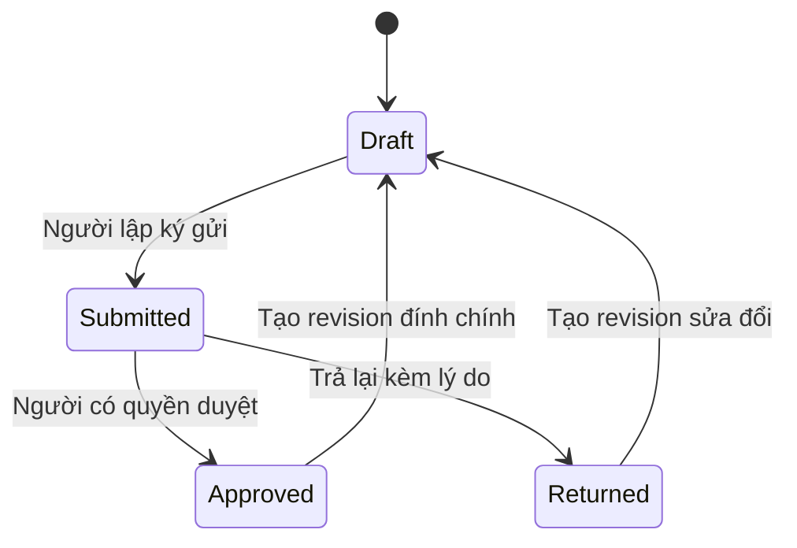
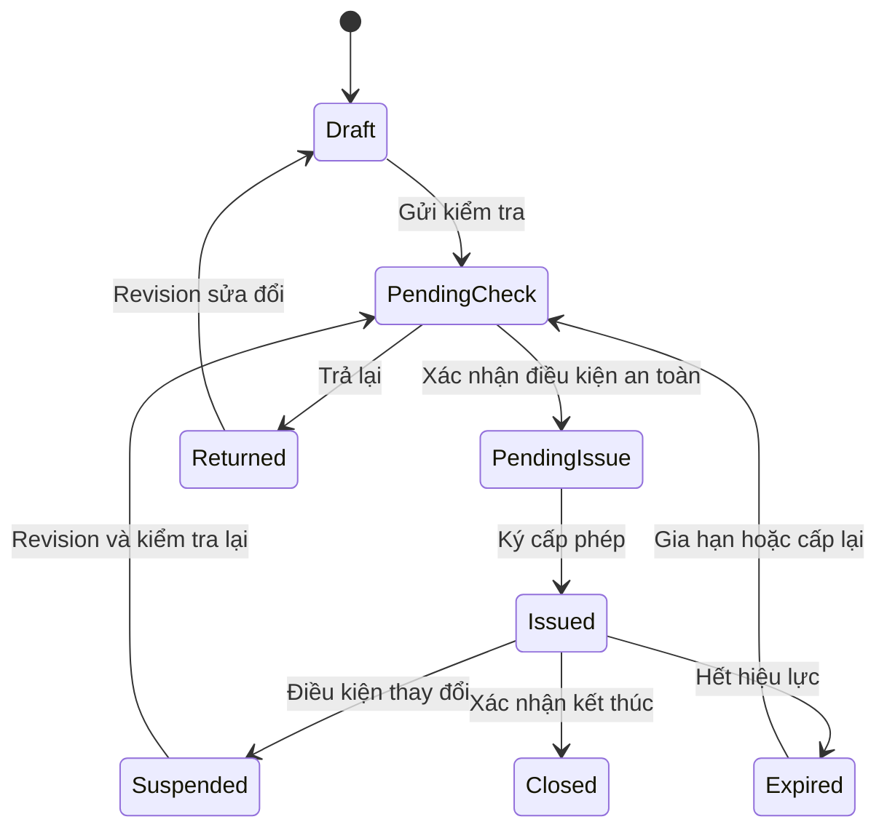

# Kế hoạch triển khai ký xác nhận và phê duyệt trên Edge

Ngày lập: 07/10/2026. Trạng thái: đã triển khai các luồng đợt đầu ngày 08/10/2026; còn cấu hình nghiệp vụ, pilot và các hạng mục giai đoạn sau. Xem [báo cáo triển khai](../EDGE_SIGN_APPROVAL_IMPLEMENTATION_2026-10-08.md) để biết phạm vi thực tế và phần còn lại.

Source đối chiếu: nhánh `dev`, commit `34e2e7eb`, sau khi merge `feature/hoang58-hiu67` và `feature/hiu67`.

## 1. Mục tiêu và phương án lựa chọn

Thống nhất ký duyệt bằng **tài khoản cá nhân đã đăng nhập + nhập lại mật khẩu khi xác nhận**. Edge tự xử lý trong mạng nội bộ tàu, lưu hồ sơ và lịch sử trước, rồi đồng bộ lên Shore khi có kết nối.

Hồ sơ thông thường dùng hai bước: người lập gửi duyệt, người có thẩm quyền duyệt hoặc trả lại. Giấy phép làm việc có bước kiểm tra an toàn, cấp phép trước khi làm và đóng phép sau khi kết thúc.

Kết quả cần đạt:

- Biết đúng ai ký, với tư cách nào, vào lúc nào và trên phiên bản nội dung nào.
- Người dùng không tự nhập danh tính/chức danh để ký thay người khác.
- Bỏ PIN mẫu `1111`, kiểm tra PIN chỉ đủ bốn số và dấu `SIG-...` được trình bày như chữ ký đã xác thực.
- Sau khi ký, nội dung được bảo vệ; mọi sửa đổi phải giữ lịch sử và yêu cầu xác nhận lại khi cần.
- Mất Internet không cản trở ký tại Edge. Đồng bộ không làm mất hoặc thay đổi ý nghĩa chữ ký.
- Dùng được các quyền, tài khoản, hàng đợi và snapshot PMS đã có; triển khai theo từng module.

Tên trên giao diện: **Ký xác nhận**, **Phê duyệt**, **Trả lại**, **Lịch sử ký**. Phương án này là xác nhận điện tử trong ứng dụng; không tuyên bố là chữ ký số dùng chứng thư hay tự động thay thế mọi sổ giấy pháp định. Nhập lại mật khẩu là tái xác thực, không phải hai yếu tố độc lập.

## 2. Phạm vi

| Nhóm | Phạm vi triển khai |
|---|---|
| SMS/biểu mẫu | Lưu nháp, gửi duyệt, duyệt/trả lại, sửa đổi có phiên bản, PDF và lịch sử ký |
| Giấy phép làm việc HSQE | Kiểm tra, cấp phép, thời hạn hiệu lực, đình chỉ, cấp lại, đóng phép |
| PMS/bảo dưỡng | Tái xác thực khi duyệt; gắn người duyệt với snapshot từng lần thực hiện; giữ tác động vật tư/chu kỳ hiện có |
| Phiếu nhập vật tư | Bổ sung danh tính và lịch sử duyệt vào luồng đã có; hoàn tất nhập kho vẫn là thao tác riêng |
| Nhật ký dầu và nhật ký khác | Áp dụng nền tảng xác thực/lịch sử theo từng loại; đánh giá riêng trước khi dùng thay sổ pháp định |
| Shore | Nhận và lưu hồ sơ ký của tàu, xem lịch sử, xuất hồ sơ; không sửa chữ ký do Edge phát sinh |

Chưa đưa vào đợt đầu: USB token, chứng thư PKI, OTP qua SMS, xác thực sinh trắc học, ký PDF bằng chứng thư, công cụ tự thiết kế workflow nhiều cấp, phê duyệt từ xa trên Shore và quy trình DPA đóng hồ sơ sự cố. Các phần này có thể mở rộng sau bằng cùng mô hình phiên bản và hành động.

## 3. Kết quả rà soát hiện trạng

Đây là kết quả đọc source, không phải chứng nhận tuân thủ hay kết quả kiểm thử mới.

| Mã | Hiện trạng | Hệ quả cần xử lý |
|---|---|---|
| F01 | `SmsController.SignRecord` chỉ kiểm tra PIN đủ bốn chữ số; tên/chức danh lấy từ request | Có quyền thao tác chưa đủ để chứng minh danh tính ghi trên chữ ký |
| F02 | `SmsController.ApproveRecord` dùng PIN cố định `1111`; chưa bắt buộc hồ sơ đang Submitted | Có thể duyệt bằng bí mật dùng chung; cần kiểm tra trạng thái và người duyệt thực tế |
| F03 | SMS cho sửa nội dung trước Approved nhưng đã có thể chứa chữ ký; không ràng buộc chữ ký với revision/hash | Nội dung sau sửa có thể khác nội dung đã xác nhận |
| F04 | HSQE nhận `Role`, `Name`, `Rank` từ request; PIN Đại phó chỉ kiểm tra định dạng, Captain dùng `1111` | Backend phải tự xác định người ký và thẩm quyền cho từng bước |
| F05 | Giấy phép tạo với `Status = Active` trước khi có đủ xác nhận | Trạng thái có thể bị hiểu là được phép làm khi chưa cấp phép |
| F06 | `RankPermissionFilter` đã chặn theo quyền, nhưng ký SMS và ký phép cùng dùng `hsqe.approve` | Cần tách quyền xác nhận, kiểm tra, cấp phép và trả lại; không chỉ sửa UI |
| F07 | PMS lấy actor từ tài khoản, có trạng thái chờ duyệt, lịch sử và snapshot | Giữ nền tảng này; bổ sung tái xác thực và chữ ký gắn từng lần thực hiện |
| F08 | Phiếu nhập có gửi/duyệt/hoàn tất nhưng thao tác duyệt chưa lưu đầy đủ actor trong bản ghi phiếu | Cần lưu danh tính/thời điểm/quyết định, giữ cơ chế nhập kho riêng |
| F09 | Nhật ký dầu nhận `MasterSignature` từ client; đã chặn sửa khi có chữ ký | Thay chuỗi tự khai bằng xác nhận từ tài khoản; sửa sai theo phiên bản/đính chính |
| F10 | Shore đưa `hsqe_work_permit`, `oil_record_book` và một số nhật ký vào `_ignoredTables` | ACK sự kiện cũ không đồng nghĩa hồ sơ đã được lưu trên bờ |
| F11 | Audit chung không được thiết kế làm điều kiện bắt buộc của nghiệp vụ ký | Hành động ký và snapshot phải được lưu cùng transaction, không dựa vào log có thể bỏ qua lỗi |

Các file chính:

- [SMS backend](../../edge_product/edge-services/Controllers/Safety/SmsController.cs), [SMS frontend](../../edge_product/frontend-edge/src/pages/HSQE/components/SmsDocumentPage.tsx).
- [HSQE backend](../../edge_product/edge-services/Controllers/Safety/HsqeController.cs), [HSQE frontend](../../edge_product/frontend-edge/src/pages/HSQE/components/RiskWorkPermits.tsx).
- [Phân quyền](../../edge_product/edge-services/Services/Core/RankPermissionFilter.cs), [quyền theo chức danh](../../edge_product/edge-services/Services/Core/RankPermissionService.cs).
- [PMS workflow](../../edge_product/edge-services/Controllers/Maintenance/TaskWorkflowController.cs), [PMS completion](../../edge_product/edge-services/Services/Maintenance/MaintenanceCompletionService.cs).
- [Phiếu nhập](../../edge_product/edge-services/Controllers/Inventory/StockReceiptController.cs), [nhật ký dầu](../../edge_product/edge-services/Services/Logbooks/OilRecordService.cs).
- [Shore inbox](../../shore_product/backend/Services/Sync/SyncInboxService.cs).

## 4. Căn cứ nghiệp vụ và giới hạn áp dụng

Permit-to-work phải xác định công việc, thời hạn, biện pháp an toàn và trách nhiệm của người cho phép/người thực hiện, kể cả bàn giao và kết thúc công việc. Nút phê duyệt phải đi cùng kiểm tra điều kiện thực tế. Tham chiếu: [HSE – Permits to work](https://www.hse.gov.uk/coshh/basics/permits.htm).

Với sổ điện tử MARPOL, hướng dẫn IMO đề cập tài khoản cá nhân, audit, bảo vệ bản gốc và thay đổi, xác thực bổ sung khi Master xác nhận và xác nhận lại sau sửa đổi. Việc dùng thay sổ giấy cần được xem xét theo cơ quan cờ tàu; quy định này không áp nguyên xi cho mọi biểu mẫu nội bộ. Tham chiếu: [IMO MEPC.312(74), đặc biệt mục 4.3 và 5](https://wwwcdn.imo.org/localresources/en/KnowledgeCentre/IndexofIMOResolutions/MEPCDocuments/MEPC.312%2874%29.pdf).

Phân công người ký từng mẫu, điều kiện cấp phép và mức xác thực cuối cùng phải khớp SMS của công ty và yêu cầu cơ quan cờ tàu. Các vai trò và ngưỡng trong kế hoạch là thiết kế đề xuất; không coi code/ngưỡng khí hiện có là tiêu chuẩn đã được xác minh.

## 5. Danh tính và phân quyền

### 5.1. Xác định người ký

Backend lấy người ký từ phiên đăng nhập đang hoạt động, rồi tra dữ liệu mới nhất theo `User.CrewId → CrewMember.RankId → RankPermissionConfig`.

Lưu cả ID và bản chụp tên tài khoản, tên thuyền viên, mã/tên chức danh tại thời điểm ký. Không thay đổi chữ ký cũ khi người đó đổi chức danh hoặc rời tàu. Người dùng không được nhập hay lựa chọn người khác làm người ký.

Thực hiện trực tiếp và ký giấy phép yêu cầu người ký có danh tính thuyền viên phù hợp, đang trên tàu. Quyền duyệt PMS tiếp tục giữ quy tắc của [kế hoạch phân quyền hiện có](RANK_MODULE_PERMISSIONS_PLAN_2026-10-06.md): không tự thêm điều kiện onboard cho mọi người duyệt PMS, không bắt buộc người duyệt là người được giao việc.

ADMIN tiếp tục quản trị và phục hồi cấu hình. PMS giữ khả năng duyệt/trả lại bằng danh tính admin theo chính sách hiện có, nhưng hiển thị rõ tài khoản quản trị; không ghi admin thành Master. Với SMS/giấy phép, quyền quản trị kỹ thuật không tự cho phép đóng vai sĩ quan hay cấp phép: cần danh tính và thẩm quyền nghiệp vụ được cấu hình.

### 5.2. Ma trận đề xuất

| Nhóm | Người lập/thực hiện | Người kiểm tra/duyệt | Quy tắc |
|---|---|---|---|
| SMS thông thường | Người được giao hoặc có quyền lập | Chức danh được cấu hình cho loại mẫu | Hai bước; người lập không tự duyệt mặc định |
| PMS bộ phận máy/boong | PIC/người thực hiện theo workflow hiện có | Người có quyền approve/reject; cấu hình thường gắn Máy trưởng/Đại phó tùy nhóm | Không hardcode tên chức danh; gắn lần thực hiện |
| Giấy phép nguy hiểm | Người phụ trách công việc | Người kiểm tra và người cấp phép theo SMS công ty | Người cấp phép khác người làm; thêm bước Master nếu mẫu yêu cầu |
| Phiếu nhập | Người nhận/ghi phiếu | Người có quyền duyệt phiếu | Người duyệt và người hoàn tất có quyền riêng |
| Nhật ký dầu | Sĩ quan chịu trách nhiệm ghi | Master xác nhận theo yêu cầu loại sổ | Không suy thẩm quyền Master chỉ từ quyền quản trị |

Đề xuất quyền mới: `hsqe.records.sign/approve/reject`, `hsqe.permits.check/issue/close/suspend`. Giữ quyền create/view/update hiện có. PMS và phiếu nhập tiếp tục dùng mã quyền đã có. Nhật ký dùng quyền hiện có cộng chính sách xác nhận của loại sổ.

Không tự chuyển mọi `hsqe.approve` thành quyền cấp phép. Migration ghi danh sách cấu hình cần rà soát; chức danh chưa cấu hình quyền mới không được ký/cấp phép. Các ngoại lệ tự duyệt, nếu công ty cần, phải được khai báo theo loại hồ sơ và được lưu lý do; mặc định không cho phép.

## 6. Luồng hồ sơ SMS và báo cáo thông thường



- **Draft:** cho sửa và lưu; lưu nháp không yêu cầu nhập lại mật khẩu.
- **Submitted:** nội dung revision đã gửi được đóng băng. Người lập ký xác nhận nội dung khi gửi; người duyệt xem đúng snapshot đó.
- **Returned:** lưu lý do và quyết định trả lại. Bản sửa tạo revision mới, không xóa lần gửi và chữ ký cũ.
- **Approved:** khóa revision và file liên quan. Sửa sai bằng revision đính chính có lý do, liên kết bản đã duyệt trước đó.
- Trong lúc bản đính chính chưa được duyệt, giao diện phân biệt “Bản đã duyệt gần nhất” và “Bản sửa đang chờ”. Khi bản sửa được duyệt, ghi sự kiện thay thế bản cũ; vẫn tra cứu được cả hai.
- Hai người duyệt đồng thời hoặc một người mở màn hình cũ: chỉ quyết định phù hợp version được chấp nhận; người còn lại phải tải lại.

Không cho gọi approve trực tiếp từ Draft. Các chữ ký nằm trong nội dung biểu mẫu dưới dạng tên gõ tay không được coi là hành động ký xác thực.

## 7. Luồng giấy phép làm việc



Tạo mới luôn là Draft. Giấy phép được phép sử dụng khi có đủ xác nhận của revision hiện hành, không bị đình chỉ và đang trong thời gian hiệu lực. Giữ thời gian cấp phép riêng với khoảng thời gian được phép làm việc; UI có thể hiển thị “Đã cấp – chưa đến giờ”.

Trước cấp phép phải kiểm tra đủ nội dung bắt buộc, đánh giá rủi ro, biện pháp cách ly/PPE/cứu hộ theo mẫu, người thực hiện, địa điểm, thời hạn và kết quả đo khí nếu áp dụng. Lưu người đo, thời điểm đo, thiết bị và kết quả; giá trị số đơn lẻ không chứng minh việc đo đã hợp lệ.

Ngưỡng và thời hạn kết quả đo phải có nguồn/quy trình công ty. Không giữ điều kiện `O2 >= 20.9` như quy tắc chung cho mọi tình huống mà chưa rà soát chuyên môn. Việc máy kiểm tra các trường không thay thế kiểm tra hiện trường của người có trách nhiệm.

- Người kiểm tra và người cấp phép dùng quyền riêng, không chọn `Role = Captain` từ client.
- Sau thay đổi đáng kể về phạm vi, địa điểm, biện pháp an toàn hoặc điều kiện đo: đình chỉ revision hiện tại, tạo bản mới và kiểm tra/cấp lại.
- Đổi ca/gia hạn phải có hành động bàn giao/xác nhận theo mẫu. Đợt đầu không hỗ trợ thì yêu cầu cấp lại, không gia hạn âm thầm.
- Đóng phép lưu người kết thúc công việc và xác nhận điều kiện bàn giao/đưa thiết bị trở lại sử dụng. Người làm báo hoàn thành; người có thẩm quyền xác nhận đóng theo mẫu.
- Hết giờ phải bị coi là hết hiệu lực ngay khi đọc/thao tác, dù worker cập nhật trạng thái chưa chạy. Không cho ký thêm vào phiếu Closed hoặc Expired để hợp thức hóa hồi tố.

## 8. Trải nghiệm giao diện

Dùng một component `ApprovalConfirmDialog` cho các module, một panel `ApprovalHistoryPanel` và nhãn trạng thái thống nhất.

Hộp xác nhận hiển thị mã/tên hồ sơ, revision, hành động, người ký và chức danh lấy từ server; có ô nhập lại mật khẩu. Trả lại/đính chính bắt buộc lý do. Người dùng xem bản chuẩn bị ký trước khi xác nhận.

Frontend phải lưu hoàn tất bản đang sửa trước khi gửi duyệt. Nếu còn thay đổi chưa lưu, yêu cầu lưu và lấy lại version, không ký âm thầm trên bản cũ. Đóng dialog phải xóa mật khẩu khỏi state; không lưu vào localStorage, cache, analytics hay URL.

Hiển thị lịch sử với tên, chức danh, thời gian, quyết định và revision. Bản cũ có nhãn “Chữ ký lịch sử chưa xác thực bằng cơ chế mới”. Bản bị thay thế không mang nhãn chữ ký còn hiệu lực của revision hiện hành.

Nút hiện theo quyền; backend vẫn kiểm tra độc lập. Trạng thái ký và trạng thái giao Shore tách riêng: “Đã ký tại tàu”, “Chờ đồng bộ”, “Đã lưu trên bờ”, “Lỗi đồng bộ”. Hiển thị thời gian theo múi giờ tàu kèm thông tin múi giờ; dữ liệu gốc lưu UTC.

PDF lấy từ snapshot đã ký, ghi mã hồ sơ/revision/người ký/chức danh/thời gian. Hình chữ ký tay, nếu thêm sau, chỉ là hình trình bày; bằng chứng chính là hành động xác thực và phiên bản. Không hiện “chữ ký số đã kiểm tra hợp lệ” khi chỉ có mã SIG.

## 9. Thiết kế backend và dữ liệu

### 9.1. Cấu trúc tối thiểu

Một dịch vụ `ApprovalService`, một dịch vụ tái xác thực dùng logic mật khẩu hiện có và các adapter nhỏ cho SMS, permit, PMS, receipt, logbook. Adapter chịu trách nhiệm kiểm tra nghiệp vụ và gọi tác động hiện có; không viết lại PMS thành workflow tổng quát.

Ba bảng đề xuất:

| Bảng | Trường chính | Mục đích |
|---|---|---|
| `approval_documents` | Id, OriginNode, VesselId nếu đã xác định, Module, RecordKey, CurrentRevision, CurrentState, Version | Liên kết hồ sơ nghiệp vụ và concurrency token |
| `approval_revisions` | Id, DocumentId, Revision, SnapshotJson, HashAlgorithm, CanonicalizationVersion, ContentHash, TemplateId/Version/Hash, CreatedAt, CreatedBy, PreviousRevisionId, ChangeReason | Nội dung bất biến mỗi lần gửi/đính chính |
| `approval_actions` | Id/EventId, DocumentId, RevisionId, Action, ActorUserId, ActorCrewId/CrewCode, ActorName, RankId/Code/Name, Authority, SignedAtUtc, Reason, ContentHash, AuthMethod, IdempotencyKey, RequestHash, PolicyVersion | Hành động và danh tính đã xác thực |

Các trường danh tính dạng snapshot giữ được lịch sử khi đổi/xóa tài khoản. Shore không đặt FK bắt buộc tới UserId cục bộ Edge. Khóa nguồn gồm NodeId và ID hồ sơ; hai tàu có RecordKey/UserId giống nhau vẫn độc lập.

Unique constraint cho document nguồn, `(DocumentId, Revision)` và `(OriginNode, ActorUserId, IdempotencyKey)`. Action có ID toàn cục; áp ràng buộc chống hai quyết định cuối cho cùng bước/revision theo chính sách. `Version` là token tăng đơn điệu được kiểm tra bằng update có điều kiện, không chỉ so sánh timestamp.

Snapshot chứa nội dung nghiệp vụ, danh sách file/hash/size, thông tin mẫu và chính sách cần thiết. Không bao gồm password, cookie, token hoặc dữ liệu phiên. Chuẩn hóa JSON có quy tắc xác định cho số, thời gian, null và thứ tự khóa; thêm bộ vector kiểm thử. Lưu bytes/chuỗi snapshot chuẩn hóa để Shore kiểm tra hash trên đúng dữ liệu, không serialize lại tùy ý.

File đã ký không được thay nội dung ở cùng đường dẫn; sửa file tạo bản mới. File chưa có hash hoặc đang tải dở không được đưa vào lần gửi duyệt. Sau này đổi đường dẫn lưu trữ vẫn giữ nguyên hash và ý nghĩa chứng cứ.

SHA-256 hỗ trợ phát hiện nội dung khác với snapshot; **không chứng minh chống sửa bởi quản trị viên có toàn quyền database**. Đợt đầu bảo vệ bằng quyền DB, chỉ cho ứng dụng append, sao lưu và đối chiếu Shore. PKI, kho lưu bất biến và timestamp độc lập là phần mở rộng nếu cần mức bảo đảm cao hơn.

### 9.2. API đề xuất

Giữ endpoint nghiệp vụ hiện có, cho gọi dịch vụ chung. Bổ sung endpoint submit/reject/amend nơi đang thiếu và read API lấy revision/actions. Request quyết định không nhận tên/chức danh người ký.

```json
{
  "expectedVersion": 7,
  "revisionId": "uuid-revision",
  "idempotencyKey": "uuid-request",
  "password": "chi-truyen-trong-request-HTTPS",
  "reason": "Ly do bat buoc khi tra lai hoac dinh chinh"
}
```

Module/record lấy từ route; action lấy từ endpoint hoặc allowlist của adapter. Không cho client tự chỉ định trạng thái đích tùy ý. Mã lỗi ổn định: 401 phiên hết hạn; 403 thiếu quyền/sai danh tính; 409 version/state/idempotency xung đột; 422 thiếu dữ liệu nghiệp vụ; 429 quá nhiều lần thử. Sai mật khẩu trả lỗi chung, không tiết lộ hash hay dữ liệu tài khoản.

### 9.3. Transaction cho một lần ký

1. Kiểm tra phiên, tài khoản hoạt động và quyền hiện tại từ database.
2. Xác minh mật khẩu bằng logic đã có; hỗ trợ tài khoản legacy bằng cùng đường xác minh/nâng cấp an toàn, không tạo cơ chế hash khác.
3. Trong transaction, khóa/kiểm tra document version, revision, trạng thái và policy; đọc lại thẩm quyền liên quan để xử lý thu hồi quyền đồng thời.
4. Kiểm tra người lập/người duyệt, nội dung/file, điều kiện riêng của module và idempotency.
5. Ghi revision nếu hành động cần snapshot mới; append action; cập nhật trạng thái và version.
6. Thực hiện tác động nghiệp vụ và ghi queue/outbox cùng transaction. PMS trừ vật tư/chốt chu kỳ đúng một lần; nhập kho chỉ khi complete.
7. Commit rồi trả receipt chứa ActionId/RevisionId/version mới. Bất kỳ bước lưu bằng chứng hoặc queue lỗi thì rollback cả quyết định.

Request trùng cùng actor/key và payload trả receipt cũ, không tạo thêm chữ ký/tác động; key bị dùng cho payload khác trả 409. RequestHash loại password khỏi dữ liệu lưu. Retry vẫn yêu cầu phiên/quyền và tái xác thực phù hợp; không dùng idempotency như cách bỏ qua xác thực.

### 9.4. Bảo vệ xác thực

- Triển khai thực tế dùng HTTPS trong mạng tàu; HTTP localhost hiện tại chỉ phục vụ phát triển.
- Giới hạn thử mật khẩu theo tài khoản và IP; đề xuất ban đầu 5 lần sai/5 phút, điều chỉnh sau thử nghiệm, không khóa cả tàu chỉ vì dùng chung IP.
- Không tái dùng xác nhận mật khẩu cho nhiều hồ sơ trong đợt đầu. Nếu cần duyệt lô sau này, người dùng xem danh sách revision cụ thể và ký đúng lô đó.
- Không dùng cơ chế ký để login/logout hộ người khác trên máy dùng chung; khóa phiên khi không sử dụng.
- Không ghi password vào audit/request body log/APM; redact các trường nhạy cảm. Ghi thất bại xác thực riêng với dữ liệu tối thiểu.
- Không lưu mật khẩu ký, password hash/salt hay token trong action/snapshot/queue gửi Shore.
- Không cho reset mật khẩu, đổi rank hoặc thu hồi tài khoản viết lại bằng chứng cũ.

## 10. Áp dụng từng module

### 10.1. SMS

Thay SignRecord bằng ký gửi revision; ApproveRecord chỉ nhận hồ sơ Submitted. Thêm trả lại và tạo bản đính chính. Tên/chức danh từ phiên; loại bỏ PIN demo và các nhãn gây hiểu nhầm. Template và dữ liệu điền được chụp cùng revision để mẫu Shore thay đổi không làm đổi hồ sơ cũ.

### 10.2. Permit

Đổi trạng thái khởi tạo thành Draft; thay hai boolean ký thành kết quả suy ra từ actions của revision hiện hành. Trong thời gian tương thích có thể cập nhật boolean cho màn hình cũ, nhưng không dùng chúng làm nguồn quyết định. Tách kiểm tra/cấp phép/đóng phép và khóa các đường API sửa trực tiếp trạng thái.

### 10.3. PMS

Giữ các trạng thái và side effect hiện tại. Mỗi lần hoàn thành có identity của lần thực hiện và revision riêng, liên kết `MaintenanceHistory.ReportSnapshot`; một task được dùng lại qua chu kỳ không được mang chữ ký chu kỳ trước sang lần mới. VerifyTask, BulkVerifyTasks, các endpoint complete/approve cũ và service nội bộ phải đi qua cùng kiểm tra.

Đợt đầu ưu tiên duyệt đơn. Duyệt lô chỉ giữ nếu chứng minh được danh sách revision đã xác nhận, rollback đúng và không bỏ qua biểu mẫu/bằng chứng bắt buộc. Không làm duyệt lô thành đường vòng tái xác thực.

### 10.4. Phiếu nhập

Giữ Draft → Submitted → Approved → Completed. Bổ sung snapshot và actor khi gửi/duyệt/trả lại; lưu chứng từ gắn hash. Phê duyệt không cộng kho; complete cộng kho đúng một lần và phải tham chiếu revision đã duyệt. Sửa số lượng/chứng từ sau gửi yêu cầu trả lại/tạo revision mới.

### 10.5. Nhật ký

Ưu tiên nhật ký dầu. Bản ghi do sĩ quan xác nhận, Master xác nhận mục hoặc nhóm mục theo thiết kế được công ty/cơ quan cờ tàu chấp nhận. Giữ nội dung gốc khi đính chính. Các loại nhật ký có yêu cầu khác nhau nên không áp cùng vai trò/chu kỳ xác nhận một cách mặc định.

## 11. Offline và đồng bộ Shore

Ký offline nghĩa là Edge và PostgreSQL trên tàu vẫn hoạt động, chỉ mất kết nối tới Shore. Không hỗ trợ ký khi trình duyệt mất kết nối tới Edge; lúc đó có thể giữ nháp nhưng chưa hiển thị ký thành công.

- Lưu giờ UTC từ Edge; ghi nguồn và trạng thái đồng hồ. Đối chiếu đồng hồ khi nối Shore, hiển thị chênh lệch nếu vượt ngưỡng được cấu hình; không sửa giờ chữ ký cũ sau đồng bộ.
- Sự kiện ký có EventId, StreamId và source NodeId; giữ identity khi retry. Truyền snapshot/actions bất biến, không dựa vào bản nghiệp vụ mới nhất để dựng lại chữ ký cũ.
- Shore thêm mirror cho ba bảng approval và API xem theo vessel/node/module/record/revision. Đây là kho chứng cứ đọc được cả khi Shore chưa có model nghiệp vụ của một loại phiếu.
- Mirror chứa snapshot đầy đủ và file refs nên có thể xem giấy phép/nhật ký qua hồ sơ approval; muốn màn hình nghiệp vụ chuyên biệt thì bổ sung mirror nghiệp vụ riêng ở giai đoạn tiếp theo.
- Capability `approvalEvidenceVersion` được thương lượng trước. Shore cũ không hỗ trợ: giữ queue và báo cần nâng cấp; không ACK thành công vì table nằm trong `_ignoredTables`.
- `_ignoredTables` hiện có không được dùng cho ba loại approval mới. Sự kiện nghiệp vụ legacy và sự kiện lưu bằng chứng có trạng thái giao riêng; UI “Đã lưu trên bờ” chỉ khi có receipt thực sự lưu chứng cứ.
- Snapshot/document phải đến trước action phụ thuộc; action đến trước được defer/retry. Không nhận action tham chiếu revision/hash khác. Không áp snapshot cũ làm lùi trạng thái hoặc ghi đè action mới.
- File lớn truyền bằng worker hiện có. Phân biệt đã lưu metadata và đã nhận đủ bằng chứng; nếu thiếu file, hiển thị thiếu bằng chứng trên bờ và giữ công việc truyền file.
- Shore xác minh node thuộc tàu, ID nguồn, hash và receipt; không diễn giải chữ ký người dùng thành chữ ký request đồng bộ hoặc ngược lại.
- Không gửi thông tin xác thực người dùng lên Shore. Shore không cần tài khoản Edge để giữ chữ ký lịch sử.

## 12. Chuyển đổi dữ liệu hiện có

Migration ưu tiên bổ sung bảng/cột, giữ nguyên hồ sơ, signature JSON và lịch sử cũ. Không tự biến PIN demo thành chữ ký được tái xác thực.

| Dữ liệu cũ | Xử lý |
|---|---|
| Hồ sơ Draft | Giữ nháp; lần gửi tiếp theo tạo snapshot/action mới |
| Submitted có chữ ký mẫu | Giữ bản gốc, đánh dấu LegacyUnverified; yêu cầu ký gửi lại revision nếu tiếp tục luồng mới |
| Approved/Closed lịch sử | Giữ trạng thái lịch sử, hiển thị nguồn xác thực cũ; không ép toàn bộ ký hồi tố |
| Permit Active nhưng chưa đủ xác nhận | Xuất danh sách kiểm tra; không cho dùng như phép đã cấp trong cơ chế mới; cần kiểm tra/cấp lại trước tiếp tục |
| Permit Active có đủ boolean nhưng chỉ PIN mẫu | Vẫn là xác nhận legacy; cần đối soát phép đang dùng với người có trách nhiệm, không tự nâng thành Verified |
| PMS lịch sử có actor/snapshot | Liên kết/backfill nguồn lịch sử nếu xác định được; không gán AuthMethod mới cho hành động cũ |
| Actor/rank không xác định | Giữ nguyên dữ liệu nguồn và nhãn không xác định; không suy người ký từ tên trùng |

Backfill phải chạy lại an toàn, có báo cáo số lượng trước/sau, kiểm tra hash và bản ghi không chuyển được. Khi cutover khóa ghi module ngắn hạn để tránh hồ sơ được tạo bằng luồng cũ giữa migration và bật cấu hình.

## 13. Danh mục thay đổi dự kiến

| Khu vực | Công việc |
|---|---|
| Edge Models/Data | Model approval, migration, constraints, concurrency và mapping nguồn; dữ liệu tương thích module |
| Edge Services/Core | ApprovalService, reauthentication, rule kiểm tra quyền/actor, idempotency, logging redaction |
| Edge Controllers | Adapter và endpoint submit/approve/reject/amend/check/issue/close; chặn đường vòng |
| Edge Services/Maintenance | Liên kết lần thực hiện/snapshot, transaction và side effect |
| Edge frontend | Dialog xác nhận, lịch sử, trạng thái, quyền, bỏ PIN mẫu, bảo vệ thay đổi chưa lưu, i18n Việt/Anh |
| Permission registry | Quyền từng bước và migration cấu hình cần đối soát |
| Edge/shore shared | DTO sync evidence, schema/canonicalization version; cập nhật đồng bộ hai bản shared hiện có |
| Edge sync | Capture immutable records, dependency, capability, receipt và file references |
| Shore Models/Data/Inbox | Mirror evidence, scope node/vessel, constraints, không ACK bỏ qua bằng chứng |
| Shore frontend/API | Xem và xuất snapshot/lịch sử, phân biệt metadata/file, bản cũ/bản hiện hành |
| Docs/operations | Hướng dẫn người dùng, cutover, backup, rollback, danh sách quyền và kiểm tra phép đang hiệu lực |

## 14. Trình tự triển khai và đầu ra

Ước lượng ban đầu cho một người triển khai toàn thời gian: **12–18 ngày làm việc**, chưa gồm chờ công ty xác nhận biểu mẫu/ngưỡng, đánh giá cơ quan cờ tàu hay mở rộng tất cả nhật ký. Đây là ước lượng, không phải cam kết lịch.

| Giai đoạn | Thời lượng dự kiến | Đầu ra và điều kiện hoàn thành |
|---|---|---|
| A. Chốt nghiệp vụ | 1–2 ngày | Ma trận mẫu/người ký, số bước, quy tắc tự duyệt, giấy phép, ngưỡng và phân loại dữ liệu cũ |
| B. Nền tảng ký | 2–3 ngày | Bảng/dịch vụ/API contract, quyền, mật khẩu, transaction, concurrency, idempotency, dialog dùng chung |
| C. SMS và permits | 3–4 ngày | Luồng mới end-to-end; bỏ PIN demo; kiểm tra thời hạn và revision; migration legacy |
| D. Mirror Shore | 2–3 ngày | Capability, snapshot/action/file sync, receipt, trang xem/xuất bằng chứng |
| E. PMS và phiếu nhập | 2–3 ngày | Tái xác thực, identity từng lần thực hiện, giữ tác động vật tư/kho/chu kỳ đúng một lần |
| F. Pilot và bàn giao | 2–3 ngày | Test lỗi/offline, UAT trên dữ liệu riêng, cutover thử, vận hành và hướng dẫn |

SMS/permit có thể thử nội bộ sau C, nhưng chỉ nghiệm thu “đồng bộ hồ sơ ký lên bờ” sau D. Nhật ký dầu đưa vào đợt tiếp theo sau khi chốt yêu cầu sổ và tiêu chuẩn xác thực; không để phạm vi này ngầm kéo dài đợt đầu.

Các vấn đề cần xác nhận ở A: ai ký từng mẫu; Master có bắt buộc cho từng permit không; bước bàn giao/đóng; cho tự duyệt trường hợp nào; quy tắc admin PMS; thời hạn/thiết bị/ngưỡng đo; retention và biểu mẫu PDF; phạm vi thay thế sổ giấy. Trong khi chờ, vẫn làm được contract dữ liệu, dịch vụ và UI cơ bản; chưa tự bật quyền cấp phép cho người dùng thật.

## 15. Kiểm thử và tiêu chí nghiệm thu

Chạy trên PostgreSQL/container và tài khoản thử riêng. Không gọi ký/phê duyệt lên hồ sơ vận hành để kiểm thử.

| Nhóm | Trường hợp bắt buộc | Kết quả mong đợi |
|---|---|---|
| Danh tính | Client giả Name/Rank/Actor; account không gắn crew; đổi rank/khóa user | Không ký thay; quyền hiện tại được kiểm tra; lịch sử cũ giữ nguyên |
| Xác thực | Sai mật khẩu, phiên hết hạn, quá số lần thử, tài khoản legacy | Không tạo action; giới hạn thử đúng tài khoản; tái xác thực nhất quán login |
| Phân quyền | Chỉ view/update; có sign nhưng không approve; ADMIN kỹ thuật; quyền vừa thu hồi | Không đi đường vòng; ghi đúng tư cách admin PMS; không giả Master |
| Workflow | Approve Draft, tự duyệt, ký phiếu đóng/hết hạn, trả lại thiếu lý do | Từ chối hoặc xử lý đúng policy đã cấu hình |
| Nội dung | Bản chưa lưu, sửa field/file/mẫu sau gửi; ký revision cũ | Ký đúng snapshot; thay đổi yêu cầu revision/xác nhận lại |
| Đồng thời | Hai người duyệt; submit trùng; timeout sau commit; key trùng payload khác | Một quyết định đúng; retry trả receipt; 409 khi xung đột |
| Transaction | Lỗi ghi action/snapshot/queue; lỗi trừ kho | Rollback quyết định và tác động; không có trạng thái duyệt thiếu bằng chứng |
| Permit | Chưa đo khí, kết quả hết hạn, thiếu checklist, chưa đến giờ, hết giờ, thay điều kiện, đổi ca | Không cấp/dùng sai; đình chỉ/cấp lại/đóng đúng luồng |
| PMS | Hai chu kỳ cùng task, duyệt lại, bulk/endpoint cũ | Hai hồ sơ thực hiện độc lập; mỗi lần trừ vật tư/chốt chu kỳ đúng một lần |
| Phiếu nhập | Duyệt rồi sửa lượng; complete lặp; request liên kết mất hiệu lực | Chặn thay đổi trái luồng; cộng kho đúng một lần |
| Sync | Offline, restart, ACK mất, retry, đảo thứ tự, hai tàu trùng ID, Shore cũ | Không mất/trùng; không giả đã lưu; cách ly scope và defer dependency |
| File | Metadata trước file, file thiếu/sai hash, đổi đường dẫn, retry chunk | Bằng chứng được kiểm tra; thiếu file thể hiện rõ; không ký file thay thế âm thầm |
| Legacy | Backfill chạy hai lần; chữ ký `1111`; không xác định actor | Không gán Verified giả; không mất hồ sơ hay queue |
| Riêng tư | Log request, audit, queue, telemetry lỗi và export | Không chứa mật khẩu/token/password hash/salt |
| Giao diện | Việt/Anh, tablet, mất kết nối Edge, tải lại sau submit | Không mất nháp; không hiện ký thành công khi chưa có receipt |

UAT tối thiểu: người lập tạo và gửi SMS; người khác trả lại; sửa/gửi lại/duyệt; xuất đúng revision. Làm thêm một permit chưa đạt điều kiện bị chặn, một permit đủ điều kiện được cấp và đóng; ký offline rồi Shore nhận đủ snapshot/actions/file. Người có trách nhiệm kiểm tra màn hình và bản PDF cùng thể hiện đúng người ký và nội dung.

Nghiệm thu đợt đầu khi SMS, permit, PMS, receipt trong phạm vi đều có danh tính đúng, tái xác thực, revision, lịch sử và không còn PIN mẫu; tất cả API thay đổi liên quan không bỏ qua workflow; Shore lưu và xem được chứng cứ; test quan trọng pass và pilot được xác nhận.

## 16. Build, triển khai và phục hồi

1. Sao lưu cả PostgreSQL, uploads, image đang chạy và source commit. Giữ provisioning, key và hàng đợi.
2. Build/test cả Edge và Shore từ source mới; kiểm tra migration trên bản sao database, backfill và báo cáo legacy.
3. Triển khai Shore mirror/capability trước. Kiểm tra nhận snapshot/action thực sự được lưu và cách ly theo vessel.
4. Triển khai Edge ở chế độ chưa bật thao tác mới; chạy migration, đối soát quyền và permit đang dùng. Đóng luồng PIN cũ trước khi mở module mới để không tồn tại hai đường ký.
5. Bật từng module theo feature flag, hoàn thành pilot và kiểm tra readiness, phiên, quyền, queue, file và PDF. Bật module không được bypass validation.
6. Theo dõi lỗi xác thực, 403/409, action trùng, tuổi queue, capability mismatch, file thiếu và permit quá hạn; không gửi nội dung mật khẩu vào dashboard/log.

Nếu có lỗi: dừng thao tác ký ở module bị ảnh hưởng, giữ đọc hồ sơ và lịch sử. Rollback chỉ dùng phiên bản hiểu schema đã mở rộng và vẫn chặn PIN demo; không tự quay về binary cũ cho phép ký `1111`. Không drop bảng action/revision đã có bằng chứng mới.

Restore database chỉ thực hiện theo quy trình sự cố có kiểm soát: dừng sync, đối soát hành động phát sinh sau backup, bảo toàn chứng cứ và tạo stream epoch mới khi cần theo [tài liệu sync hiện có](../SYNC_IMPLEMENTATION_2026-10-06.md). Không coi restore ảnh cũ là cách xóa một chữ ký nghiệp vụ.

## 17. Checklist bàn giao

- [ ] Có ma trận trách nhiệm và nguồn quy trình cho từng mẫu/permit.
- [ ] Tài khoản cá nhân, chức danh và quyền được cấu hình; không dùng chung tài khoản để ký.
- [ ] Tái xác thực, revision, action và receipt được kiểm thử.
- [ ] Bỏ PIN demo, ô tự khai người ký và nhãn chữ ký số chưa có căn cứ.
- [ ] Ký/duyệt/tác động nghiệp vụ/queue atomic; có chống trùng và xung đột.
- [ ] Permit cấp trước khi làm, có thời hạn, đình chỉ/cấp lại và đóng đúng trách nhiệm.
- [ ] Hồ sơ legacy được giữ và phân loại, không xác thực hồi tố bằng migration.
- [ ] Shore thực sự lưu bằng chứng và file; UI không nhầm ACK legacy với đã lưu hồ sơ.
- [ ] Snapshot/PDF/lịch sử khớp cùng revision; chữ ký cũ không đổi khi rank/mẫu thay đổi.
- [ ] Có hướng dẫn vận hành offline, backup, xử lý sự cố và rollback không mở lại PIN mẫu.
- [ ] Phạm vi nhật ký pháp định và điều kiện chấp thuận được ghi riêng trước khi dùng thay sổ giấy.

## 18. Tài liệu liên quan

- [Kế hoạch quyền theo chức danh](RANK_MODULE_PERMISSIONS_PLAN_2026-10-06.md).
- [Rà soát quyền thao tác](RANK_MODULE_ACTIONS_AUDIT_2026-10-06.md).
- [PMS dùng lại task và giữ lịch sử](PERIODIC_MAINTENANCE_SINGLE_TASK_2026-10-06.md).
- [Audit đồng bộ PMS](PERIODIC_MAINTENANCE_SYNC_AUDIT_2026-10-06.md).
- [Triển khai sync](../SYNC_IMPLEMENTATION_2026-10-06.md), [sửa hướng sync](../SYNC_DIRECTION_FIXES_2026-10-06.md).

Kế hoạch này bổ sung cơ chế xác thực và bằng chứng cho các luồng hiện có. Mọi thay đổi chính sách so với tài liệu cũ, đặc biệt admin, tự duyệt và thẩm quyền cấp phép, phải được ghi rõ khi chốt giai đoạn A; không coi nội dung đề xuất là phần mềm đã triển khai.

## 19. Cập nhật phạm vi ký ngày 08/10/2026

Đã mở rộng cơ chế tài khoản + tái xác thực + snapshot/action/queue sang nhật ký và các điểm ký còn lại. Xem [báo cáo thống nhất luồng ký](../UNIFIED_EDGE_SIGNING_2026-10-08.md). Đánh giá việc dùng nhật ký điện tử thay sổ pháp định và pilot nghiệp vụ vẫn cần thực hiện riêng.
