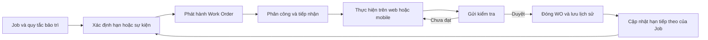
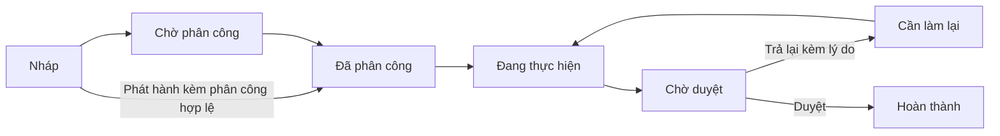

# Kế hoạch tách Job List và Work Order trong PMS

Ngày: 25/10/2026. Trạng thái: đã thống nhất nghiệp vụ và wireframe; đang triển khai backend và giao diện mới trên `hiu67-rework`, chưa chuyển luồng vận hành.

Đây là thiết kế đích, không phải mô tả toàn bộ chức năng đã chạy. Schema, API Job/WO, workflow thực hiện–duyệt và giao diện mới đang được bổ sung; xem [tiến độ và ranh giới triển khai](PMS_REWORK_IMPLEMENTATION_PROGRESS_2026-10-25.md). API mới tắt mặc định; frontend chỉ chọn giao diện mới khi catalog backend đã bật Job List. Chưa nối worker phát hành mới hoặc chuyển dữ liệu vận hành. Phần thực hiện PMS trên web trước rework đã được commit tại `4ae551ef`. Phần ảnh không thuộc phạm vi mới. Luồng PMS mới cũng bỏ các tab/biểu mẫu ĐGRR và BBKT; chỉ giữ hồ sơ cũ ở chế độ đọc khi cần bảo toàn lịch sử.

**Cách đọc nhanh:** mục 7 mô tả màn hình và nút dành cho người dùng. Các mục còn lại mô tả quy tắc xử lý, chuyển dữ liệu và triển khai để những màn hình này hoạt động đúng.

**Điều chỉnh phạm vi dữ liệu demo (26/10/2026):** người dùng cho phép xóa dữ liệu PMS cũ vì không cần giữ. Với môi trường demo này, chọn khởi tạo Job/WO mới từ dữ liệu sạch, không bắt buộc chuyển các task/lịch sử/cấu hình cũ. Các yêu cầu bảo toàn/chuyển đổi legacy ở dưới vẫn là phương án cho môi trường có hồ sơ cần giữ; không còn là điều kiện bắt buộc của lần reset demo này. Không xóa thiết bị, liên kết vật tư–thiết bị, danh mục vật tư, tồn kho, thuyền viên, tài khoản, chức danh/quyền hoặc dữ liệu phân hệ khác. Không hoàn tác tồn kho/counter đã ghi chỉ vì xóa báo cáo PMS cũ.

Reset phải có phạm vi tàu/nút nguồn cụ thể, kiểm kê bảng con và liên kết, ngừng writer/worker PMS cũ và chặn gói đồng bộ/mobile từ trước reset ở cả hai đầu trước khi xóa. Không dùng `TRUNCATE ... CASCADE`, xóa toàn bộ hàng đợi, đổi stream chung hoặc xóa kho bằng chứng ký dùng chung để làm sạch PMS. Hàng đợi PMS cũ được đối chiếu và xử lý riêng theo mốc reset; hàng đợi phân hệ khác giữ nguyên. Chỉ bật luồng mới khi kiểm thử xác nhận gói cũ không khôi phục dữ liệu đã xóa. Cho phép xóa dữ liệu không đồng nghĩa đã thực hiện reset; kết quả thực tế ghi tại tài liệu tiến độ.

## 1. Kết luận về hiện trạng

Hệ thống **đã có các bảng phân biệt cấu hình, công việc và lịch sử**, nhưng đang trộn Job và Work Order ở vòng đời xử lý và cách trình bày. Không phải toàn bộ PMS nằm trong một bảng.

| Thành phần hiện tại | Vai trò đang có | Vấn đề cần tách |
| --- | --- | --- |
| `MaintenanceSchedule` | Thiết bị/nhóm thiết bị, mã công việc, chu kỳ, checklist mẫu, mặc định phân công | Gần với Job Definition/kế hoạch bảo trì, nhưng tên gọi và thao tác chưa thể hiện rõ ranh giới với lệnh thực hiện |
| `MaintenanceTask` | Người được giao, checklist thực tế, kết quả, trạng thái, gửi duyệt | Đồng thời đóng vai dòng công việc ổn định và lần thực hiện hiện tại |
| `MaintenanceHistory` | Snapshot báo cáo từng lần | Đang phải bù cho việc task được xóa dữ liệu thực hiện rồi dùng lại ở kỳ sau |
| `MaintenanceCycleUpdater` và `PeriodicTaskCycle` | Cập nhật trạng thái chu kỳ | Sau khi duyệt có thể đưa chính task vừa hoàn thành về SCHEDULED, reset kết quả/checklist/biểu mẫu cho kỳ mới |
| `WorkPlanningPage` | Bảng, lịch, Gantt, Counter, cấu hình | Người dùng khó phân biệt đang xem danh mục việc phải bảo trì hay một lệnh thực hiện cụ thể |

Căn cứ mã nguồn:

- [Các model PMS](../../edge_product/edge-services/Models/EdgeModels.cs).
- [Bộ cập nhật chu kỳ](../../edge_product/edge-services/Services/Maintenance/MaintenanceCycleUpdater.cs).
- [Cơ chế tái sử dụng task](../../edge_product/edge-services/Services/Maintenance/PeriodicTaskCycle.cs).
- [Xử lý hoàn thành](../../edge_product/edge-services/Services/Maintenance/MaintenanceCompletionService.cs).
- [Giao diện hiện tại](../../edge_product/frontend-edge/src/pages/PMS/WorkPlanningPage.tsx).
- [Quyết định một task trước đây](PERIODIC_MAINTENANCE_SINGLE_TASK_2026-10-06.md).

**Thay đổi so với quyết định trước:** trước đây một công việc định kỳ giữ nguyên task qua nhiều kỳ. Đề xuất mới giữ **một Job ổn định**, nhưng **mỗi lần thực hiện là một Work Order có ID riêng**. Mong muốn không có nhiều dòng trùng trong danh sách được đáp ứng ở Job List, không bằng cách tái sử dụng Work Order.

## 2. Mô hình nghiệp vụ đích

| Khái niệm | Trả lời câu hỏi | Ví dụ |
| --- | --- | --- |
| Job Definition | Thiết bị cần làm việc gì, theo quy tắc nào? | Kiểm tra và bảo dưỡng máy bơm cứu hỏa mỗi 3 tháng |
| Job List | Danh sách các Job và tình trạng kế hoạch hiện tại | Một dòng cho Job máy bơm: chu kỳ, hạn tới, bộ phận, WO đang mở |
| Work Order — WO | Lần này ai làm, hạn nào, kết quả gì, ai duyệt? | WO-BDS-20261025-001, giao Phó ba, hạn 25/10 |
| Lịch sử thực hiện | Lần đó đã thực hiện và phê duyệt như thế nào? | Báo cáo, thông số, checklist, vật tư, người làm/người duyệt, các lần trả lại |



Quy tắc cốt lõi:

1. Job có ID và mã ổn định; sửa Job không sửa ngược kết quả các WO đã phát hành.
2. WO có ID/mã riêng cho từng kỳ. WO hoàn thành giữ COMPLETED, không đổi lại SCHEDULED.
3. Trả lại để làm lại vẫn là **cùng WO**, tăng số lần trả lại và giữ các bản báo cáo đã gửi trước đó.
4. Kỳ sau tạo WO mới liên kết cùng Job. Job List vẫn chỉ có một dòng của Job đó.
5. Job và WO không bắt buộc quan hệ 1–1: một Job có nhiều WO theo thời gian; WO đột xuất có thể không có Job.
6. Trạng thái đến hạn, trạng thái WO, tình trạng thiết bị là ba khái niệm khác nhau.

## 3. Cấu hình Job và phân công

### 3.1. Thông tin Job

Tận dụng `MaintenanceSchedule`, trước mắt chưa đổi tên toàn bộ bảng/model để giảm phạm vi migration:

- Mã Job nội bộ, `WorkCode` gốc từ Excel, tên, hướng dẫn.
- Một thiết bị cụ thể và bộ checklist mẫu; mỗi Job mới chỉ gắn một thiết bị trong V1.
- Loại bảo trì đang có: PERIODIC, DRY_DOCK, ON_DEMAND, VOYAGE; giữ xử lý việc AD_HOC/CORRECTIVE riêng.
- Chu kỳ ngày/tháng/năm, giờ chạy hoặc HYBRID đối với loại có chu kỳ. Không quy đổi 3 tháng thành 90 ngày.
- Mức ưu tiên mặc định, bộ phận/chức danh và người chịu trách nhiệm quản lý Job.
- Không có lựa chọn bắt buộc ĐGRR/BBKT hoặc ảnh trong form Job mới. Các cờ yêu cầu biểu mẫu cũ chỉ được giữ để đọc dữ liệu legacy, không làm điều kiện gửi/duyệt trong luồng mới.
- Chính sách phát hành WO, chế độ phân công, phiên bản Job, trạng thái Cần bổ sung thông tin/Hoạt động/Tạm dừng/Ngừng áp dụng. Không có bước kích hoạt hoặc trạng thái Nháp riêng cho Job; Nháp trong tài liệu chỉ áp dụng WO thủ công.
- Mốc khởi tạo kế hoạch và hạn tiếp theo; các giá trị lần thực hiện gần nhất được cập nhật từ WO đã duyệt.

V1 mỗi Job gắn một thiết bị cụ thể; cây nhóm chỉ tổ chức và lọc, không phải đối tượng nhận Job mới. Job theo giờ/HYBRID dùng counter của chính thiết bị đó, không lấy MAX giờ cả nhóm. HYBRID gồm chu kỳ lịch và chu kỳ giờ, có mốc/cảnh báo riêng từng đơn vị; điều kiện đến trước phát hành một WO, điều kiện còn lại không tạo lệnh thứ hai cho cùng kỳ. Khi duyệt, cả hai mốc kỳ sau được cập nhật theo lần gửi hoàn tất và số đo trong báo cáo được duyệt.

Job nhóm legacy phải được kiểm kê riêng trước chuyển đổi: giữ hồ sơ/WO đang mở, không tự nhân bản lịch sử hoặc phát hành theo thiết bị chưa xác định. Chỉ đưa cấu hình mới vào tự sinh khi đã đối soát phạm vi và mapping từng thiết bị; trường hợp chưa đủ thông tin giữ Cần bổ sung thông tin. Không xóa Job nhóm cũ hoặc mở lại quyền tạo Job nhóm mới để né chuyển dữ liệu.

### 3.2. Hai chế độ phân công

| Chế độ | Cấu hình tại Job | Xử lý khi phát hành WO |
| --- | --- | --- |
| Phân công khi phát hành — mặc định | Chưa chọn người thực hiện mặc định; vẫn có thể có người quản lý Job | WO vào Chờ phân công; người có quyền chọn PIC và người hỗ trợ |
| Phân công trước | Có cá nhân mặc định, hoặc quy tắc chức danh/bộ phận | Kiểm tra người đó còn trên tàu và phù hợp trước khi gán; không hợp lệ thì chuyển Chờ phân công |

Không tự chọn ngẫu nhiên một người khi nhiều thuyền viên cùng chức danh. Chức danh chịu trách nhiệm của Job không đồng nghĩa một cá nhân đã nhận WO.

Phân biệt **người chịu trách nhiệm Job** và **người thực hiện WO**: ví dụ Đại phó quản lý Job máy bơm cứu hỏa, nhưng WO kỳ này giao Phó ba. Cột người chịu trách nhiệm trên Bảng hiển thị người quản lý Job; cột người thực hiện trên Work Order hiển thị người được giao lần đó. Nếu có người thực hiện mặc định, đây là một thiết lập phân công riêng, không tự lấy người quản lý Job làm người thực hiện.

Sửa mặc định phân công trên Job chỉ áp dụng cho WO phát hành sau đó. Thay PIC của WO đang mở phải là thao tác phân công lại có lịch sử và thông báo riêng. Người rời tàu không tiếp tục được thực hiện WO; bàn giao giữ kết quả đã ghi nhận và danh tính người làm trước.

## 4. Khi nào phát hành Work Order?

Đề xuất chính sách mặc định cho giao diện mới: **ON_UPCOMING — phát hành từ khoảng sắp đến hạn**, ví dụ trước 7 ngày hoặc trước 50 giờ chạy theo cấu hình phù hợp. Nhờ đó tab Work Order có các WO thật ở cả Sắp đến hạn, Đến hạn và Quá hạn. Đến hạn chỉ thay tình trạng hạn của WO đó, không tạo thêm một WO khác.

ON_DUE vẫn là tùy chọn nếu công ty chỉ muốn phát hành đúng hạn. Với lựa chọn này, Job sắp đến hạn chỉ nằm ở Bảng; không giả lập thêm một dòng WO chưa phát hành để lấp đầy bộ lọc Sắp đến hạn. Không tự dùng số ngày cảnh báo làm số giờ cảnh báo; hai đơn vị phải được cấu hình rõ.

Tách thời điểm phát hành khỏi quyền tự động phát hành: Job có thể phát hành tự động hoặc chỉ phát hành thủ công. Khi chuyển dữ liệu, giữ ý nghĩa `AutoGenerate=false` hiện có; import hoặc migration không tự bật chế độ tự động cho các Job đang được giữ để rà soát.

| Tình huống | Cách phát hành |
| --- | --- |
| Định kỳ ngày/tháng/năm | Theo hạn lịch và chính sách phát hành đã chọn |
| Giờ chạy | Theo counter thực tế; ngày dự kiến chỉ để tham khảo, không tự làm việc quá hạn |
| HYBRID | Ngưỡng đến trước trong hai điều kiện, theo cấu hình đã duyệt |
| Lên đà | Gắn đợt lên đà cụ thể; không giả lập bằng hạn ngày mặc định |
| Theo yêu cầu | Có yêu cầu/sự kiện được người có quyền phát hành xác nhận |
| Theo chuyến | Gắn chuyến đi/sự kiện cụ thể, đúng tàu |
| Hư hỏng/đột xuất | Tạo WO trực tiếp cho thiết bị; không bắt buộc tạo một Job định kỳ giả |

### 4.1. Khởi tạo lần đầu — nhập mốc và Lưu, không kích hoạt riêng

- Form Thêm/Sửa Job có nhóm **Mốc bắt đầu tính chu kỳ** và lựa chọn **Tự động tạo WO**. Đủ thông tin thì bấm Lưu là Job được theo dõi; không thêm popup/nút Kích hoạt.
- Job thiếu mốc hoặc thiết bị/thông tin bắt buộc được lưu ở Cần bổ sung thông tin, chỉ rõ phần thiếu, không tự thành Quá hạn và không phát hành WO. Mở cùng form Sửa để bổ sung; đủ dữ liệu rồi Lưu thì chuyển Hoạt động, trừ khi Job đang được chủ động tạm dừng/ngừng áp dụng.
- Với chu kỳ lịch, mốc bắt đầu cộng chu kỳ ra hạn đầu; theo giờ dùng số counter mốc cộng chu kỳ giờ, không đặt lại counter thiết bị. HYBRID phải đủ cả hai mốc. Có thể nhập mốc bảo trì có nguồn đối chiếu nhưng không tạo báo cáo hoàn thành giả hoặc coi là lần làm được duyệt.
- Job sự kiện dùng quy tắc/sự kiện tương ứng, không bắt nhập ngày/counter không liên quan. Mỗi đợt/chuyến/yêu cầu phải được xác định rõ khi phát hành WO.
- Giữ quyết định bỏ hai cột “Lần thực hiện cuối” và “Hạn tiếp theo” khỏi Excel import thông thường. Import không nhập lịch sử thực hiện, không tự bật AutoGenerate. Nếu thiếu mốc thì bổ sung bằng form Sửa; import lại không thay mốc hoặc chính sách của Job đang vận hành một cách ngầm định.
- Checkbox Tự động tạo WO mặc định tắt cho Job mới; Job cũ giữ lựa chọn hiện có. Job Hoạt động vẫn được theo dõi hạn khi tắt tự động, nhưng người có quyền phải phát hành WO thủ công.
- Lưu Job không đồng nghĩa phát hành ngay: chỉ Job Hoạt động, đủ điều kiện và bật tự động mới được service phát hành WO. Nếu tại thời điểm lưu đã vào khoảng phát hành thì có thể phát hành ngay; form phải xem trước/cảnh báo điều này, phản hồi mã WO hoặc trạng thái chờ worker rõ ràng. Thiếu dữ liệu hoặc lỗi phát hành không được báo thành công có WO khi chưa tạo.
- Sau khi đã có WO/lịch sử, mốc gốc không được sửa tùy ý để đẩy hạn. Chỉnh mốc trong cùng form phải có quyền, lý do, xem trước ảnh hưởng và nhật ký; không sửa hạn/kết quả WO đã phát hành. Mốc kỳ tiếp theo do WO đã duyệt cập nhật, không nhập trực tiếp vào ô Hạn tới.

### 4.2. Chống sinh WO trùng

- Thêm `CycleKey`/số thứ tự kỳ ổn định, có unique constraint theo tàu + Job + phạm vi thiết bị + kỳ.
- Với Job mới V1, phạm vi là đúng thiết bị của Job. Trường phạm vi trong khóa được giữ để đối soát legacy, không có nghĩa form mới cho chọn cả nhóm. Đổi thiết bị của Job đã có WO/lịch sử phải tạo Job riêng hoặc qua chuyển đổi có kiểm soát; không sửa AssetId để né khóa kỳ.
- Bản phát hành mang `JobVersion`; **không dùng phiên bản Job làm khóa kỳ**, tránh sửa cấu hình lại sinh thêm WO cho cùng kỳ.
- Với sự kiện, khóa kỳ lấy từ ID đợt lên đà/yêu cầu/chuyến đi tương ứng. WO đột xuất dùng idempotency key riêng cho thao tác tạo.
- Giai đoạn đầu tối đa một WO chưa kết thúc cho một Job/phạm vi thiết bị. Worker chạy lại hoặc tàu offline lâu không sinh hàng trăm WO bù khi kỳ trước vẫn đang làm/chờ duyệt.
- Nếu nhiều chu kỳ đã bị bỏ lỡ, ghi nhận số kỳ bỏ lỡ/tình trạng quá hạn để xử lý; không tạo các WO “đã hoàn thành” thay cho dữ liệu thiếu.
- Phát hành thủ công và worker dùng cùng một service, khóa giao dịch và unique constraint. Không gọi hai luồng tạo độc lập.
- Trong V1, hủy WO không được coi là đã làm xong kỳ, không tự tăng kỳ hoặc đẩy hạn Job. Kỳ bị hủy chặn tự phát hành lại và hiển thị Cần xử lý kỳ đã hủy tại Job; worker không tạo vòng lặp WO hủy/tạo lại. Việc phát hành thay thế cho cùng kỳ cần thiết kế riêng về khóa kỳ/lần thay thế, chưa có nút trong V1; không bỏ unique constraint để xử lý tạm.

## 5. Vòng đời WO và tình trạng hạn

### 5.1. Trạng thái xử lý



- Tạo thủ công có thể lưu Nháp hoặc phát hành khi đủ thông tin. WO do worker phát hành có thể vào Chờ phân công hoặc Đã phân công nếu mặc định hợp lệ.
- WO đột xuất V1 nhập hạn theo ngày tàu (`YYYY-MM-DD`) hoặc counter. Chưa mở trường hạn có giờ; ngày hạn được server chuyển đổi theo múi giờ tàu và theo quy tắc cả ngày ở mục 5.2. Nháp thiếu thiết bị vẫn giữ checklist mẫu riêng, chỉ tạo checklist thực hiện khi phát hành với thiết bị thật.
- Tiếp nhận ghi `AcceptedAt/AcceptedBy` và sự kiện nghiệp vụ. Có thể cho nút Bắt đầu đồng thời tiếp nhận; ACK đồng bộ không phải xác nhận nhận việc của thuyền viên.
- WO đã phát hành và phân công hợp lệ thì người được giao/hỗ trợ có quyền thực hiện được bắt đầu, kể cả Chưa đến hạn/Sắp đến hạn; không chặn thêm bằng ngày hoặc ngưỡng giờ. Quyền phát hành sớm được kiểm tra ở bước phát hành của người quản lý, không bắt người làm xin lại một quyền làm sớm. Đây là thay đổi so với luồng cũ, phải áp dụng thống nhất web/mobile/backend.
- Gửi duyệt đóng băng báo cáo đã gửi; trả lại tạo lượt sửa tiếp theo trong cùng WO và giữ phiên bản cũ.
- Hoàn thành là trạng thái kết thúc sau duyệt. Sửa hồ sơ đã duyệt phải qua cơ chế amendment riêng, không cho sửa đè hoặc mở lại tùy ý ở giai đoạn đầu.
- Hủy WO cần lý do và quyền riêng. Xóa theo nhóm Thêm/xóa chỉ áp dụng WO nháp chưa phát hành; không xóa lệnh đã thực hiện/đã duyệt để làm mất lịch sử.

### 5.2. Tình trạng hạn là thông tin độc lập

- Hiển thị Chưa đến hạn/Sắp đến hạn/Đến hạn/Quá hạn ở cột tình trạng hạn, không dùng để thay trạng thái xử lý WO.
- Với hạn chỉ có ngày: Sắp đến hạn trong khoảng cảnh báo trước ngày hạn; Đến hạn trong ngày hạn theo múi giờ tàu; Quá hạn từ đầu ngày kế tiếp. Hạn có giờ cụ thể phải lưu chính xác thời điểm và quy tắc đánh dấu đến/quá hạn, không tự dùng quy tắc cả ngày. Với counter: dưới ngưỡng cảnh báo là Chưa đến hạn, từ ngưỡng cảnh báo đến dưới hạn là Sắp đến hạn, bằng hạn là Đến hạn, vượt hạn là Quá hạn. Counter có thể tăng vượt thẳng qua hạn nên không đảm bảo từng thấy mọi nhãn trung gian. HYBRID xét điều kiện chạm trước, ghi rõ nguyên nhân ngày/giờ; không so trực tiếp hai đơn vị. Cần cấu hình quy tắc chính xác cho hạn có giờ trước khi triển khai, không để web/mobile tự tính khác nhau.
- Một WO có thể đồng thời Đang thực hiện và Quá hạn. Không đổi trạng thái thành OVERDUE rồi làm mất thông tin đang thực hiện.
- WO đã hoàn thành trễ vẫn là Hoàn thành, kèm cờ hoàn thành trễ; không nằm trong bộ đếm WO đang quá hạn.
- Thời điểm người thực hiện gửi kết quả và thời điểm người kiểm tra duyệt được lưu riêng. Báo cáo đúng hạn của người làm không bị biến thành làm trễ chỉ vì duyệt muộn; có thể thống kê chậm duyệt riêng.
- Gia hạn WO là một quy trình có duyệt, không tự sửa chu kỳ Job. Khi trả lại, giữ hạn đã được chấp thuận, trừ khi có quyết định gia hạn mới.
- V1 không bổ sung UI gia hạn, amendment báo cáo đã duyệt hoặc tính WO đột xuất thay thế kỳ định kỳ. Giữ liên kết/hồ sơ gia hạn legacy khi di trú; các khả năng mở rộng này cần thiết kế riêng trước khi có nút, không mặc nhiên thuộc nút Cập nhật.

## 6. Dữ liệu và tính toàn vẹn

### 6.1. Tận dụng cấu trúc hiện có

| Thành phần | Hướng chỉnh sửa |
| --- | --- |
| `MaintenanceSchedule` | Là nguồn Job Definition; thêm version, chính sách phát hành/phân công và mốc khởi tạo |
| `MaintenanceTask` | Là WO; mỗi kỳ có GUID/mã mới, liên kết `ScheduleId` trực tiếp; giữ nguyên WO hoàn thành |
| Checklist mẫu | Thuộc phiên bản Job |
| Vật tư đã gán cho thiết bị | Quản lý tại giao diện thiết bị; Job chỉ đọc để tham khảo, không có danh sách vật tư gán riêng |
| Checklist/kết quả/vật tư thực tế | Thuộc WO; tách dự kiến khỏi thực tế và lưu danh tính người ghi nhận |
| `MaintenanceHistory`/`ReportSnapshot` | Tiếp tục là dữ liệu bất biến; phân biệt lịch sử legacy và lịch sử gắn với WO mới |
| Phân công | Chuẩn hóa PIC/người hỗ trợ/chức danh từ metadata hiện có; không tiếp tục dùng chuỗi tên hoặc nhúng JSON trong hướng dẫn làm quan hệ chính |
| Phê duyệt, gia hạn, kho | Liên kết WO và phiên bản/lượt báo cáo cụ thể |

Lịch sử/báo cáo của WO đột xuất phải tồn tại được khi không có Job. Model Edge hiện có `MaintenanceHistory.ScheduleId` bắt buộc; thiết kế schema mới cần cho phép liên kết Job nullable đối với loại báo cáo này hoặc bổ sung bảng báo cáo WO riêng, đồng thời cập nhật mirror Shore. Đề xuất ưu tiên liên kết Job nullable và WO bắt buộc cho báo cáo mới; không tạo Schedule giả chỉ để thỏa FK. Liên kết legacy phải được giữ riêng khi chưa xác định được WO lịch sử.

Mã Job, mã WO và mã thiết bị là ba mã khác nhau. Giữ `WorkCode` của file maintenance plan; không coi mã công việc là mã thiết bị. Không tìm cấu hình bằng cách cắt chuỗi mã SCHED; dùng FK.

WO lưu snapshot của phiên bản Job khi phát hành: nội dung, checklist, phạm vi thiết bị, ưu tiên và hạn. Nếu cần lưu danh sách vật tư tham khảo tại thời điểm phát hành thì lấy từ liên kết vật tư–thiết bị, ghi rõ nguồn; không coi đó là vật tư đã sử dụng hoặc danh sách gán riêng của Job. Sửa Job không tự thêm/xóa checklist của WO đang thực hiện. WO chưa bắt đầu chỉ được cập nhật theo Job mới qua thao tác có kiểm soát và ghi lịch sử. Snapshot/bằng chứng biểu mẫu cũ đã ký được giữ nguyên để xem lịch sử, không biến thành biểu mẫu bắt buộc của WO mới.

### 6.2. Khi phê duyệt

Trong cùng giao dịch và có chống lặp:

1. Kiểm tra trạng thái, quyền, phiên bản hồ sơ và xác nhận ký hiện có.
2. Lưu kết quả, lần trả lại, chữ ký/bằng chứng và snapshot bất biến.
3. Hạch toán vật tư thực tế đúng một lần, có khóa liên kết WO/dòng vật tư; gửi lại cùng quyết định không trừ lần hai.
4. Lưu giờ chạy tại lúc thực hiện riêng khỏi counter hiện tại. Khi duyệt, chỉ nâng counter nếu số ghi nhận cao hơn counter mới nhất; không hạ counter nếu thiết bị đã chạy tiếp trong lúc chờ duyệt. Kiểm tra số đo theo thời điểm/chuỗi số đo, không từ chối báo cáo chỉ vì counter hiện tại đã cao hơn số đo hợp lệ lúc thực hiện.
5. Đóng WO thành Hoàn thành.
6. Cập nhật Job: lần thực hiện đã được xác nhận và hạn kỳ tiếp theo. Không reset WO vừa đóng.
7. Ghi outbox đồng bộ và sự kiện thông báo sau khi giao dịch thành công.

V1 tính hạn kỳ sau từ **ngày gửi hoàn tất của lượt cuối được duyệt**, không lấy ngày bấm duyệt muộn và không giữ hạn gốc như lịch cố định. Ví dụ chu kỳ 3 tháng, hạn 25/10 nhưng gửi hoàn tất 23/10 và duyệt 27/10 thì hạn sau là 23/01. Theo giờ: số giờ ghi nhận trong báo cáo được duyệt + chu kỳ giờ. HYBRID tính cả hai ngưỡng mới theo hai mốc này. Chỉ khi duyệt mới cập nhật mốc chính thức; trả lại/gửi lại/lưu kết quả đang làm không đẩy hạn. Lịch cố định theo hạn gốc là mở rộng về sau, không có bộ chọn trong V1.

Trong V1, “Ngày thực hiện” dùng thời điểm **gửi hoàn tất của lượt cuối được duyệt**, hiển thị rõ nhãn **Ngày gửi hoàn tất** ở bảng/báo cáo; chưa có ô khai ngày hoàn tất thực tế riêng. Nếu trả lại và gửi lần 2 thì dùng thời điểm gửi lần 2, vẫn giữ mốc lần 1 trong timeline. Không suy diễn lần gửi cuối đồng nghĩa ngày bảo trì thực địa nếu về sau cho khai báo hồi tố. Định kỳ giờ chạy lấy số đo gắn lượt được duyệt làm mốc, không lấy counter mới nhất tại lúc duyệt. Không tạo chuỗi WO bù tự động.

WO đột xuất sửa cùng một thiết bị không được tính là hoàn tất Job định kỳ trong V1. Nếu về sau cho tính thay thế phải có thiết kế xác nhận phạm vi và quyền phù hợp riêng. Tình trạng thiết bị phải xét các WO còn đang thực hiện, không tự về Hoạt động khi vẫn còn lệnh bảo trì khác.

## 7. Giao diện và quyền

### 7.1. Màn hình Danh sách công việc

Giữ một mục Danh sách công việc trên sidebar và cây thiết bị bên trái. Thanh tab bên phải:

```text
Bảng  |  Work Order  |  Lịch  |  Gantt chart  |  Counter
```

**Bỏ hẳn tab Cấu hình**, không chỉ đổi tên hoặc ẩn bằng cờ. Các thao tác còn dùng ở Cấu hình chuyển vào đúng vị trí trên Bảng. Không bổ sung các tầng tab Nháp/Đang làm/Chờ duyệt bên trong Work Order; dùng bộ lọc để giao diện gọn.

| Tab | Người dùng vào để làm gì? | Dữ liệu hiển thị |
| --- | --- | --- |
| Bảng | Quản lý danh mục những việc phải bảo trì | Mỗi Job một dòng ổn định |
| Work Order | Phân công, thực hiện, kiểm tra từng lần bảo trì | Mỗi WO đã phát hành một dòng; nháp thủ công chỉ xem khi chọn Nháp/Tất cả |
| Lịch | Xem lịch các lệnh đã phát hành | Cùng nguồn WO và điều kiện lọc của tab Work Order |
| Gantt chart | Xem tiến độ/hạn của các lệnh đã phát hành | Cùng WO; bấm lệnh mở chi tiết WO |
| Counter | Ghi nhận giờ chạy thiết bị | Counter thực tế và các Job liên quan |

Giai đoạn này Lịch/Gantt chỉ hiển thị WO, không chèn Job dự báo thành lệnh chưa tồn tại. Hạn dự kiến của Job xem ở Bảng/Chi tiết công việc. Chưa thêm một màn dự báo lịch Job thứ hai để tránh tăng độ rối.

Cây thiết bị lọc Bảng theo thiết bị của Job, lọc Work Order/Lịch/Gantt theo thiết bị của WO, lọc Counter theo thiết bị đo. Chuyển tab giữ lựa chọn thiết bị. Bảng và Counter giữ bộ lọc/trang riêng. Work Order/Lịch/Gantt chia sẻ điều kiện nghiệp vụ (Job nguồn, tiến độ, người làm, tình trạng hạn); mỗi góc nhìn giữ riêng trang/vị trí cuộn/khoảng thời gian hiển thị. Nháp không lên Lịch/Gantt; chọn Nháp rồi chuyển sang hai tab này phải hiển thị rõ chỉ xem lệnh đã phát hành, không giữ một bộ lọc ẩn gây trang trống. Quay lại từ màn chi tiết phải về đúng tab/bộ lọc trước đó.

### 7.2. Tab Bảng chính là Job List

Các cột mặc định:

| Cột | Ý nghĩa/hiển thị |
| --- | --- |
| STT, ô chọn | Số thứ tự và chọn các Job đủ điều kiện thao tác hàng loạt |
| Tên công việc | Nội dung Job, bấm để xem Chi tiết công việc |
| Tên thiết bị | Một thiết bị cụ thể của Job; cây nhóm chỉ dùng tổ chức/lọc |
| Loại / chu kỳ | Ví dụ **Định kỳ · 3 tháng (3M)**, **Định kỳ · 1 năm (1Y)**, **Định kỳ · 8.000 giờ**, **Lên đà**, **Theo yêu cầu**, **Theo chuyến**; không chỉ ghi “Định kỳ” |
| Lần cuối thực hiện | Ngày gửi hoàn tất/giờ chạy của lượt gần nhất đã được duyệt; chưa có thì ghi Chưa có lịch sử. Mốc đối chiếu nhập khi khởi tạo có nhãn Mốc khai báo riêng, không coi là báo cáo đã duyệt |
| Hạn tới | Ngày hoặc ngưỡng giờ chạy; mốc giờ chạy có thể kèm số giờ còn lại. Ngày ước tính phải ghi rõ là dự kiến |
| Bộ phận | Bộ phận chịu trách nhiệm Job |
| Người chịu trách nhiệm | Người quản lý Job; nếu chưa chọn cá nhân thì thể hiện chức danh và tình trạng chưa chọn người |
| WO đang mở | Mã lệnh/tình trạng hiện tại, bấm để sang tab Work Order lọc đúng Job; không có thì ghi Chưa phát hành |
| Trạng thái Job | Cần bổ sung thông tin/Hoạt động/Tạm dừng/Ngừng áp dụng; kèm phần thiếu hoặc Cần xử lý kỳ đã hủy nếu có. Job xóa mềm chưa có WO được ẩn mặc định, có thể lọc Đã xóa và khôi phục theo quyền |
| Hành động | Xem, sửa Job, lịch sử; quyền/trạng thái quyết định nút được dùng |

Mã Job vẫn có trong chi tiết, tìm kiếm và xuất Excel; không buộc thêm một cột mã dài vào bảng mặc định. Neo STT/ô chọn/Tên công việc và cột Hành động; tiêu đề và dữ liệu cùng kích thước cột, chữ dài có tooltip.

Thanh công cụ của **Bảng** đặt: **Thêm công việc**, **Import Excel**, **Tải mẫu**, **Xuất danh sách**, **Xóa đã chọn** theo quyền. Job đã có WO/lịch sử chỉ được ngừng áp dụng, không xóa làm mất liên kết; nút xóa hàng loạt phải giải thích rõ dòng không đủ điều kiện.

Nút **Thêm công việc** mở một form Job thống nhất, thay cho form/tab/popup cấu hình rời rạc. Form có các nhóm:

1. Tên công việc, mã, thiết bị, hướng dẫn, mức ưu tiên mặc định.
2. Loại bảo trì, chu kỳ, mốc bắt đầu và chính sách phát hành tương ứng, checkbox Tự động tạo WO; Lên đà/Theo yêu cầu không bị ép nhập chu kỳ tháng. Bổ sung mốc bằng cùng form này, không có bước kích hoạt riêng (mục 4.1).
3. Bộ phận, chức danh/người chịu trách nhiệm Job; tùy chọn phân công khi phát hành hoặc người thực hiện mặc định.
4. Checklist mẫu. Có thể hiển thị thêm mục **Vật tư của thiết bị** ở chế độ chỉ đọc, lấy danh sách đã được gán qua giao diện thiết bị; không gọi đây là vật tư dự kiến của Job.

Form Thêm/Sửa Job không có nút thêm vật tư, chọn/gán/bỏ gán vật tư hoặc chỉnh số lượng vật tư dự kiến. Việc quản lý liên kết vật tư–thiết bị chỉ thực hiện tại giao diện thiết bị theo quyền tương ứng. Thiết bị chưa có vật tư được gán thì hiển thị trạng thái trống. Có thể bỏ hẳn mục tham khảo này nếu không cần, không tạo thêm cơ chế gán vật tư tại Job.

Không có trường kết quả thực hiện, vật tư đã dùng, người duyệt, ảnh, ĐGRR hay BBKT trong form Job. **Lưu công việc là lưu Job, không có nghĩa đã thực hiện hoặc đã hoàn thành một WO.** Đủ dữ liệu thì Job được theo dõi; thiếu thì Cần bổ sung thông tin. Job hoạt động/bật tự động có thể phát hành WO khi đủ điều kiện ngay sau Lưu theo mục 4.1; mọi WO vẫn do service phát hành riêng, có thông báo mã WO, không trộn hai đối tượng thành một bản ghi.

### 7.3. Tab Work Order là nơi xử lý công việc thực tế

Cột mặc định: **STT, Mã WO, Tên công việc, Tên thiết bị, Hạn hoàn thành/ngưỡng giờ, Tình trạng hạn, Trạng thái xử lý, Người thực hiện, Ưu tiên, Hành động**. Bộ phận và Job nguồn có thể bật thêm bằng lựa chọn cột hoặc xem trong chi tiết.

Bộ lọc tích hợp vào hàng ngay dưới tiêu đề các cột, theo bảng hiện có của hệ thống, không đặt thêm thanh tìm kiếm/bộ lọc hoặc chip trạng thái bên ngoài bảng:

- Tình trạng hạn: Tất cả, Chưa đến hạn, Sắp đến hạn, Đến hạn, Quá hạn, Chưa có hạn. Không có hạn sự kiện chưa được xác định phải có nhãn rõ, không tự Quá hạn.
- Tiến độ: Đang mở (mặc định: đã phát hành, chưa kết thúc), Chờ phân công, Đã phân công, Đang thực hiện, Cần làm lại, Chờ duyệt; Nháp, Hoàn thành, Đã hủy hoặc Tất cả là lựa chọn thêm.
- Người thực hiện, bộ phận, thiết bị ở cột tương ứng; có thể chọn chính mình trong cột Người thực hiện, không cần checkbox “Của tôi” riêng trên toolbar. Mặc định vẫn xem toàn tàu.

Mặc định hiển thị **tất cả WO còn mở**. Không làm mất một WO Đang thực hiện hoặc Chờ duyệt chỉ vì người dùng không chọn một nhãn hạn. WO đã duyệt rời danh sách đang mở, vẫn tìm lại được bằng bộ lọc và trong Lịch sử bảo trì.

Thanh công cụ có **Tạo WO đột xuất** cho người có quyền; không có Import Job hoặc sửa chu kỳ tại đây. Phát hành sớm từ Job là thao tác riêng trong Chi tiết công việc, không tạo lại Job và không tạo thêm WO nếu kỳ đó đã có lệnh.

| Trạng thái WO | Người được phép làm gì? | Nút dẫn tới đâu? |
| --- | --- | --- |
| Nháp thủ công | Người có quyền sửa/phát hành; chỉ xóa khi còn nháp | **Sửa / Phát hành** → form WO đột xuất; không có nút thực hiện/duyệt |
| Chờ phân công | Người có quyền phân công chọn PIC/người hỗ trợ | **Phân công** → popup phân công của WO |
| Đã phân công | Người được giao tiếp nhận/bắt đầu | **Thực hiện** → màn Thực hiện WO; nút Nhận và bắt đầu |
| Đang thực hiện | Người được giao tiếp tục cập nhật kết quả | **Tiếp tục thực hiện** → màn Thực hiện WO |
| Cần làm lại | Người được giao đọc lý do và sửa kết quả | **Thực hiện lại** → cùng WO, lượt sửa mới |
| Chờ duyệt | Người có quyền kiểm tra/duyệt; người thực hiện chỉ xem bản đã gửi | **Kiểm tra / duyệt** → màn Kiểm tra WO; **Xem** → chi tiết chỉ đọc |
| Hoàn thành | Xem báo cáo cuối, lịch sử các lượt xử lý | **Xem kết quả** → báo cáo đã khóa |
| Đã hủy | Xem lý do và lịch sử hủy | **Xem** → chi tiết chỉ đọc |

Một người có cả quyền thực hiện và duyệt vẫn mở **hai màn theo hai hành động khác nhau**; không có một màn gom tất cả nút. Các nút không phù hợp bị bỏ khỏi giao diện; nút có quyền nhưng thiếu điều kiện cần hiển thị lý do rõ. Backend kiểm tra lại cùng điều kiện.

### 7.4. Chi tiết công việc là chi tiết Job

Tiêu đề ghi **Chi tiết công việc — [Tên Job]**. Nội dung gồm thiết bị, hướng dẫn, loại/chu kỳ, mốc tính hạn, hạn tới, bộ phận/người chịu trách nhiệm, checklist mẫu và WO đang mở. Nếu hiển thị vật tư thì chỉ đọc danh sách đã gán cho thiết bị, không thêm/sửa/gán tại đây.

Các hành động: **Sửa công việc**, **Xem Work Order**, **Lịch sử bảo trì**, **Phát hành WO** nếu có quyền và chưa có lệnh cho kỳ này. Không có nút Bắt đầu, Hoàn thành hay Phê duyệt trên chi tiết Job. Job không phải đối tượng được báo cáo hoàn thành.

Menu quản lý Job có **Tạm dừng**, **Ngừng áp dụng**, **Tiếp tục áp dụng** theo trạng thái/quyền; không có Kích hoạt. Bổ sung mốc dùng nút Sửa. Tạm dừng/ngừng áp dụng chỉ dừng phát hành kỳ mới, không tự hủy WO đang mở. Tiếp tục áp dụng phải xem trước mốc/hạn, giữ khóa kỳ và lịch sử; thiếu dữ liệu chuyển Cần bổ sung thông tin, không tự sinh bù. Phát hành thủ công mở popup xác nhận thiết bị, kỳ/sự kiện, hạn và lý do nếu phát hành sớm ngoài khoảng cảnh báo, không chỉ bấm là tạo. Khi đã phát hành và phân công thì người được giao được thực hiện, không cần quyền làm sớm khác. Job chưa hoạt động/thiếu mốc/sự kiện hoặc kỳ đã có WO (kể cả đã hủy) không được phát hành bằng đường này.

Popup sửa Job dùng cùng form với Thêm công việc. Sửa chu kỳ/checklist tại đây chỉ có hiệu lực với các WO phát hành sau, hoặc phải dùng thao tác cập nhật lệnh chưa bắt đầu có kiểm soát như mục 6.

### 7.5. Chi tiết WO là màn xem thông tin lần thực hiện

Tiêu đề ghi **Chi tiết Work Order — [Mã WO]**. Đây là màn chỉ đọc: Job nguồn, phiên bản nội dung đã phát hành, thiết bị, hạn, PIC/hỗ trợ, tiến độ, kết quả mới nhất và timeline giao/nhận/bắt đầu/gửi/trả lại/duyệt.

Từ đây người dùng chọn **Thực hiện**, **Kiểm tra / duyệt** hoặc **Phân công** theo trạng thái/quyền. Các nút chỉ điều hướng sang màn nghiệp vụ hoặc popup phù hợp, không biến màn chi tiết thành một form vừa cấu hình vừa thực hiện vừa duyệt.

### 7.6. Màn Thực hiện WO

Màn dành cho người được giao, trên web hoặc mobile, gồm:

- Thông tin lệnh và hướng dẫn được phát hành: **chỉ đọc**, không sửa Job, hạn hoặc người phụ trách tại đây.
- Checklist thực hiện: hoàn thành từng mục, giá trị đo và ghi chú/bất thường.
- Kết quả bảo trì: báo cáo, thời gian thực hiện, giờ chạy ghi nhận.
- Vật tư thực tế: ghi nhận vật tư đã sử dụng, số lượng và ghi chú theo quyền/quy tắc kho hiện hành. Đây là kết quả của WO, không phải thao tác thêm danh mục vật tư hoặc gán vật tư cho Job/thiết bị.
- Nếu bị trả lại: lý do trả lại nổi bật, xem được bản đã gửi trước đó và nhập vào bản sửa hiện tại.

Hành động đúng giai đoạn: **Quay lại**, **Nhận và bắt đầu** khi Đã phân công; **Bắt đầu làm lại** khi Cần làm lại; **Lưu kết quả**, **Hoàn thành và gửi duyệt** chỉ khi Đang thực hiện. Cần làm lại mở bản sửa kế thừa nhưng chỉ cho nhập sau khi Bắt đầu làm lại chuyển về Đang thực hiện. Khi gửi xong, chuyển sang màn xem bản đã gửi/Chi tiết WO và hiển thị Chờ duyệt. Không còn form sửa tiếp dưới một hồ sơ đang chờ duyệt.

Thời gian thực hiện trên UI thống nhất đơn vị giờ; API hiện dùng `ActualDurationMinutes` thì chuyển đổi đúng một lần ở lớp DTO (ví dụ 1,5 giờ = 90 phút). Không đổi tên nhãn sang giờ nhưng gửi nguyên giá trị phút. Checklist không có hạng mục thì không chặn gửi vì thiếu checklist; với hạng mục bắt buộc phải kiểm tra kết quả theo cấu hình và backend.

Không có Phê duyệt/Trả lại trên màn thực hiện. Không có ĐGRR, BBKT hoặc ảnh. Nút Quay lại không có nghĩa hủy WO; hủy là thao tác quản lý riêng có lý do/quyền.

### 7.7. Màn Kiểm tra / duyệt WO

Màn dành cho người kiểm tra, mở từ WO Chờ duyệt:

- Hiển thị người làm/người hỗ trợ, lần gửi, hạn và thời điểm hoàn tất/gửi; phân biệt làm trễ với duyệt trễ.
- Xem hướng dẫn/checklist đã phát hành đối chiếu kết quả, số đo, báo cáo và vật tư thực tế.
- Toàn bộ kết quả **chỉ đọc**, không sửa thay người thực hiện, không có checkbox nhập liệu hoặc ô ghi kết quả như màn thực hiện.
- Xem timeline và các bản đã gửi/trả lại; biết rõ đang duyệt lượt báo cáo nào.

Chỉ có **Quay lại**, **Trả lại để sửa** và **Phê duyệt**. Trả lại phải nhập lý do; thao tác duyệt/trả lại dùng xác nhận và ghi bằng chứng của WO theo cơ chế hiện hành. Bỏ biểu mẫu ĐGRR/BBKT không có nghĩa bỏ xác thực người duyệt hoặc nhật ký quyết định.

Trả lại đưa cùng WO về Cần làm lại; không tạo WO mới. Duyệt đóng WO, ghi lịch sử, hạch toán kho và cập nhật Job. Không có Lưu kết quả/Bắt đầu/Hoàn thành trên màn duyệt, kể cả người dùng có cả hai nhóm quyền.

### 7.8. Lịch sử bảo trì và báo cáo đã hoàn thành

Icon **Lịch sử bảo trì** đặt ở hàng Job và trong Chi tiết công việc. Mở popup lớn ở giữa, dùng bảng chuẩn của hệ thống, có tìm kiếm/lọc/phân trang.

Cột: **STT, Mã WO, Kỳ/hạn bảo trì, Ngày gửi hoàn tất, Người thực hiện, Ngày duyệt, Người duyệt, Kết quả đúng/trễ hạn, Hành động**. Giờ chạy/thời gian thực hiện xem thêm trong báo cáo hoặc bật cột khi cần. Lịch sử legacy thiếu thời điểm gửi chỉ hiển thị thời điểm nguồn có nhãn phù hợp; không lấy ngày duyệt thế chỗ ngày gửi.

- Mỗi WO đã duyệt là một dòng. Hai lần bị trả lại rồi mới được duyệt vẫn là một WO, không tính thành ba lần bảo trì.
- Bấm **Xem báo cáo** mở bản hoàn thành đã khóa, gồm checklist/số đo, báo cáo, vật tư, người làm/người duyệt và timeline các lượt gửi/trả lại.
- Báo cáo không có nút thực hiện hoặc duyệt lại; kỳ sau là WO khác của cùng Job.
- Dữ liệu cũ không xác định được mã WO có nhãn Lịch sử cũ và ID báo cáo nguồn, không bịa mã WO hoặc gán vào WO hiện tại.
- WO đã hủy xem trong bộ lọc WO/nhật ký, không tính là một lần bảo trì đã hoàn thành.

Không giữ thêm một popup “Danh sách cấu hình” làm đường quản lý Job thứ hai. Các link Chi tiết công việc/Lịch sử bảo trì cũ được chuyển tới đúng Job, WO hoặc báo cáo qua mapping, không mở nhầm form có quyền ghi.

### 7.9. Chuyển và dọn các chức năng cũ

| Chức năng hiện có | Vị trí/kết quả trong giao diện mới |
| --- | --- |
| Tab Cấu hình, danh sách cấu hình, thêm/sửa cấu hình | Bỏ các cửa vào cũ; quản lý Job bằng Bảng và form Thêm/Sửa công việc |
| Import Excel, tải mẫu công việc | Thanh công cụ tab Bảng, chỉ nạp Job |
| Cấu hình chu kỳ/checklist mẫu | Form Job, không nằm trong màn Thực hiện/Duyệt WO |
| Gán vật tư cho thiết bị | Chỉ tại giao diện thiết bị; form/chi tiết Job có thể hiển thị danh sách đó ở chế độ chỉ đọc, không có thao tác thêm/gán vật tư |
| Giao PIC/người hỗ trợ cho một lần làm | Popup Phân công WO tại tab Work Order |
| Bắt đầu, lưu kết quả, hoàn thành/gửi duyệt | Màn Thực hiện WO |
| Trả lại, phê duyệt | Màn Kiểm tra / duyệt WO |
| ĐGRR/BBKT trong PMS | Bỏ tab, nút lưu/in/ký, trường bắt buộc và điều kiện chặn ở luồng mới; hồ sơ cũ đã lưu/ký chỉ đọc khi cần truy xuất |
| Ảnh thực hiện | Không dùng trong luồng mới, không khôi phục lại qua thiết kế này |
| Popup Lịch sử bảo trì | Danh sách các lần WO đã được duyệt của Job và báo cáo legacy |
| Lịch/Gantt | Chỉ dùng WO thật, cùng điều kiện lọc; không ghi đè kết quả hoặc sửa cấu hình Job |
| Counter | Ghi counter thiết bị; ảnh hưởng tính hạn/phát hành WO qua service, không trực tiếp mở lại lệnh cũ |
| Màn chi tiết PMS cũ có nút sửa trạng thái trực tiếp | Bỏ đường ghi cũ; chuyển link sang Chi tiết WO hoặc màn nghiệp vụ đúng quyền |
| Kanban đang ẩn, component/hook/state/service không còn sử dụng | Kiểm kê nơi dùng; xóa phần PMS không còn tham chiếu sau khi chuyển giao, không giữ bằng cờ ẩn vô thời hạn |

Việc dọn mã bao gồm route/menu, component, state, request nền, API ghi, quyền và bản dịch không còn dùng; không chỉ xóa tab bằng CSS. Các adapter tương thích mobile/queue/lịch sử có lý do tồn tại phải được cô lập, có kiểm thử và điều kiện gỡ bỏ, không cắm vào form nghiệp vụ mới. Không xóa biểu mẫu của các module HSQE khác vì yêu cầu này chỉ áp dụng PMS.

Không xóa bảng hoặc sửa hash hồ sơ ĐGRR/BBKT đã ký để “làm sạch”. Đưa ra khỏi luồng nhập/duyệt mới; chỉ giữ đường đọc/tệp lưu trữ cần thiết. Job/WO cũ mang cờ RequireRiskAssessment/RequireInspectionReport không được làm luồng mới tiếp tục đòi điền/ký biểu mẫu đã bỏ; việc này phải có test và quy tắc chuyển đổi cho cả web/mobile/backend.

Giữ style bảng, popup, thanh tab và cây thiết bị của hệ thống. Job/WO/lịch sử phân trang ở server, không tải toàn bộ thiết bị/checklist/snapshot để dựng một tab. Màn thực hiện và màn duyệt dùng chung thành phần hiển thị báo cáo khi phù hợp, nhưng có form/hành động và kiểm tra quyền riêng; tránh sao chép nguyên một trang lớn rồi ẩn nút bằng cờ.

### 7.10. Thống nhất style toàn bộ giao diện PMS

Đây là yêu cầu bắt buộc khi thiết kế và nghiệm thu: **bảng bên ngoài, popup bên trong và các màn phụ phải cùng một hệ giao diện**, không mỗi màn một kiểu. Lấy style hiện có của hệ thống làm chuẩn; không tự tạo theme, bộ màu hoặc kiểu component riêng cho PMS.

- Áp dụng cho Job List, Work Order, Lịch, Gantt, Counter; form Thêm/Sửa công việc, popup Phân công, Chi tiết Job/WO, màn Thực hiện, màn Kiểm tra/duyệt, Lịch sử bảo trì và báo cáo kết quả.
- Thống nhất font, cỡ chữ theo cấp nội dung, màu sắc, khoảng cách, đường viền, bo góc và cách trình bày tiêu đề. Giữ cùng quy ước nút chính/phụ/nguy hiểm, icon, tooltip, trạng thái vô hiệu và thông báo.
- Bảng trong popup dùng cùng thành phần hoặc quy chuẩn với bảng ngoài: màu/chiều cao tiêu đề, hàng lọc, chiều cao dòng, đường kẻ, căn lề, checkbox, badge trạng thái, icon hành động, phân trang và trạng thái trống/đang tải/lỗi. Không thu nhỏ chữ hoặc đổi kiểu bảng chỉ vì nằm trong popup.
- Với các bảng Job List, WO, Counter và Lịch sử: tìm kiếm/lọc đặt ngay dưới tiêu đề từng cột như Excel. Cột chữ dùng ô tìm kiếm, loại/trạng thái/người dùng bộ chọn phù hợp, ngày dùng khoảng ngày tại cột. Sắp xếp bằng icon tại tiêu đề cột có ý nghĩa sắp xếp; không có thanh Sort riêng hoặc bộ lọc trùng trên toolbar. Không thêm filter/sort cho STT, checkbox, Hành động hoặc cột không có nhu cầu. Chỉ áp dụng cho cột được hỗ trợ; mã không hiển thị có thể tìm qua ô tên với placeholder rõ “Tên hoặc mã”. Toolbar giữ số lượng và nút nghiệp vụ. Lịch/Gantt không có cấu trúc bảng lọc tương đương thì chỉ giữ điều hướng thời gian và điều kiện cần thiết, không nhân đôi các bộ lọc.
- Các form dùng chung kiểu nhãn, ô nhập/chọn, đánh dấu bắt buộc, lỗi xác thực và bố trí nhóm trường. Nội dung chỉ đọc có cách hiển thị nhất quán; phân biệt rõ với trường được chỉnh sửa.
- Popup và màn chi tiết thống nhất cách bố trí tiêu đề, nút đóng/quay lại, vùng nội dung, thanh hành động và cuộn. Kích thước thay đổi theo nội dung và màn hình nhưng không tạo nhiều thanh cuộn lồng nhau hoặc làm nút/tiêu đề bị che.
- Màn Thực hiện và màn Duyệt khác nhau ở nội dung được nhập và hành động được phép, nhưng giữ cùng ngôn ngữ giao diện. Không dùng hai bộ CSS/layout không liên quan cho cùng một báo cáo.
- Ưu tiên component dùng chung và biến style hiện có; sửa điểm thiếu nhất quán tại thành phần chung khi phù hợp, tránh sao chép CSS rồi chỉnh riêng từng màn. Lịch/Gantt có cách hiển thị chuyên biệt nhưng thanh công cụ, bộ lọc và popup vẫn theo chuẩn hệ thống.

Trước nghiệm thu phải đối chiếu cùng một luồng **Bảng → Chi tiết Job → Work Order → Thực hiện → Duyệt → Lịch sử → Báo cáo**, ở màn hình rộng và hẹp. Kiểm tra cả popup bên trong, dữ liệu dài và các trạng thái trống/tải/lỗi; không chỉ duyệt ảnh màn hình danh sách bên ngoài.

### 7.11. Nguyên tắc quyền

- Giữ dữ liệu đọc trong phạm vi toàn tàu như quyết định hiện tại; không tự đổi thành chỉ nhìn được việc của mình. “Của tôi” chỉ là bộ lọc người dùng chọn.
- Chức danh là nguồn cấp quyền; Crew/Admin là vai trò tài khoản, không phải chức danh.
- Quyền quản lý Job, tạo WO, phân công, thực hiện, duyệt/trả lại là các năng lực khác nhau. Có quyền cập nhật cấu hình không đồng nghĩa được thực hiện hoặc duyệt.
- Thực hiện WO cần quyền execute và là PIC/người hỗ trợ được giao, còn onboard. Đây là điều kiện thao tác, không phải bộ lọc dữ liệu; phải bổ sung kiểm tra phân công vào service mới vì filter hiện tại chủ yếu kiểm tra quyền và thuyền viên onboard.
- Người duyệt cần quyền theo SMS/PMS công ty; không cần là người được giao làm. Không tự suy ra quyền chỉ vì thứ tự chức danh cao hơn.
- Đề xuất không tự duyệt chính phần việc mình thực hiện; người tạo/phân công vẫn có thể kiểm tra nếu không phải người thực hiện. Cơ chế ngoại lệ nếu có phải do công ty chốt và có nhật ký.
- Giữ khả năng admin không liên kết thuyền viên kiểm tra/duyệt theo quyền hiện tại; không cho giả danh người thực hiện.

Tách module `pms.jobs` cho Job List, giữ `pms.work` cho WO và module Counter hiện có. Switch truy cập bao gồm quyền xem, không thêm checkbox Xem trùng. Giữ cách gom Thêm/xóa/import và Cập nhật/phân công trên giao diện; backend vẫn kiểm tra từng endpoint, trạng thái và người thực hiện. Bảng sau là ma trận nghiệp vụ cần ánh xạ vào registry/API khi triển khai, không phải các permission key mới đã tồn tại trong code:

| Module / quyền trên màn phân quyền | Phạm vi được phép | Điều kiện / giới hạn |
| --- | --- | --- |
| Job List — Truy cập | Danh sách, chi tiết Job, lịch sử và báo cáo đã hoàn thành liên quan, kể cả báo cáo legacy | Xem toàn tàu; không bao gồm danh sách WO đang mở hoặc quyền ghi |
| Job List — Thêm / xóa | Thêm Job, import, tải mẫu; xóa Job chưa có WO/lịch sử | Không xóa hồ sơ đang dùng; cập nhật Job qua import cần quyền Cập nhật, không dùng quyền Thêm để sửa lén |
| Job List — Cập nhật | Sửa nội dung/chu kỳ/mốc có kiểm soát, trách nhiệm, tự động tạo WO; tạm dừng/ngừng/tiếp tục áp dụng | Không sửa kết quả hoặc hạn WO đã phát hành |
| Work Order — Truy cập | Danh sách/chi tiết WO, Lịch/Gantt và kết quả/báo cáo WO | Xem toàn tàu; không tự có quyền sửa Job |
| Work Order — Thêm / xóa | Tạo WO đột xuất và nhập nội dung trong lần tạo, xóa nháp; phát hành WO từ Job hoặc WO đột xuất | Kiểm tra Job, kỳ, thiết bị và điều kiện phát hành; phát hành sớm ngoài cảnh báo phải có lý do. Sửa nháp đã lưu dùng quyền Cập nhật |
| Work Order — Cập nhật | Sửa nháp đã lưu, phân công/phân công lại, hủy WO chưa kết thúc có lý do | Không sửa kết quả người làm, không hủy WO đã hoàn thành; chờ duyệt phải trả lại trước khi đổi phân công |
| Work Order — Thực hiện | Nhận/bắt đầu, bắt đầu làm lại, nhập checklist/số đo/vật tư/báo cáo, lưu và gửi duyệt | Là PIC/hỗ trợ, còn onboard, đúng trạng thái; không cấp quyền duyệt hoặc cấu hình |
| Work Order — Duyệt / ký | Kiểm tra và phê duyệt lượt đang chờ duyệt | Không cần là người được giao; không sửa kết quả; không tự duyệt phần mình thực hiện theo quy tắc đã nêu |
| Work Order — Trả lại | Trả lượt đang chờ duyệt về Cần làm lại | Bắt buộc lý do, giữ nguyên WO và phiên bản đã gửi |
| Counter — Truy cập / Cập nhật | Xem counter / ghi số giờ mới theo từng quyền | Không reset đồng hồ hoặc lùi số; không mở lại WO hoàn thành |

Hành động ghi cần quyền truy cập module tương ứng; bật truy cập không tự tick quyền ghi. Xuất danh sách chỉ xuất dữ liệu người dùng có quyền xem, dùng chính sách xuất hiện có, không tạo thêm quyền ghi. Quản lý phân quyền chỉ dành cho admin theo cơ chế hiện hành, không nằm trong quyền nghiệp vụ của Job/WO.

Quyền đọc báo cáo dùng điều kiện **có quyền xem WO đó hoặc có quyền xem Job mà báo cáo đã hoàn thành thuộc về**, kiểm tra tàu và FK phía backend. Người chỉ được xem Job mở lịch sử/báo cáo của Job mà không phải cấp toàn bộ module WO; không được dùng lối này để xem kết quả đang làm/chờ duyệt. WO đột xuất không có Job chỉ đọc qua quyền WO. Link WO đang mở trên Job chỉ dẫn sang chi tiết khi có quyền WO; thiếu quyền đích thì không có link thao tác, không làm mất phiên. Người chỉ có quyền WO được xem snapshot Job trong lệnh, nhưng muốn mở màn quản lý Job vẫn cần quyền Job.

Chuyển quyền cũ: `pms.config` truy cập → Job List truy cập; Thêm/xóa/import → nhóm Thêm/xóa, Cập nhật → nhóm Cập nhật. `pms.work` cũ tiếp tục cấp khả năng WO tương ứng; Counter giữ quyền hiện có. Alias `pms.config.*` chỉ để tương thích chuyển tiếp, không tạo thêm mục Cấu hình trong UI. Với quyền cũ không có đối ứng chính xác hoặc khi gom nhóm làm mở rộng năng lực, migration phải báo cáo và giữ quyền backend hẹp cũ cho đến khi admin lưu lại nhóm quyền mới; không tự cấp hủy/phát hành/phân công chỉ vì user từng được cập nhật một trường khác. Đối chiếu quyền trước/sau và test API trực tiếp là điều kiện cutover, không chỉ kiểm tra ẩn nút.

Quyền hủy/phát hành và điều kiện thực hiện theo phân công phải khai báo rõ, kiểm tra ở cả API và giao diện. Không dùng quyền execute để sửa cấu hình, phân công lại hoặc hủy WO.

### 7.12. Vai trò trong demo, không phải hard-code

| Chức danh demo | Quyền được cấu hình cho kịch bản |
| --- | --- |
| Đại phó | Xem/quản lý Job thuộc phạm vi nghiệp vụ, tạo/phát hành/phân công WO, kiểm tra/duyệt/trả lại |
| Phó ba | Xem toàn tàu, nhận và thực hiện WO được giao, lưu/gửi kết quả; không tự duyệt |
| Thuyền trưởng | Xem tổng quan và báo cáo toàn tàu; không mặc định phải duyệt mọi WO |
| Máy trưởng | Quản lý/phân công/kiểm tra công việc máy theo quyền công ty cấp |
| Máy hai/ba/tư, Thợ máy | Thực hiện WO được giao theo quyền |
| Sĩ quan điện | Tạo/tiếp nhận công việc điện nếu được cấp các quyền tương ứng |
| Thủy thủ trưởng | Phân công việc boong nếu có quyền assign |
| Cadet | Hỗ trợ dưới người phụ trách; không tự có quyền ký xác nhận/duyệt |

Thông báo nhận việc, phân công lại, trả lại và duyệt phải lưu bền vững theo WO/người nhận, không chỉ có toast. Retry không tạo nhiều thông báo giống nhau. Tàu offline với bờ vẫn thao tác được khi thiết bị kết nối Edge; thông báo mobile được lấy lại khi kết nối Edge phục hồi.

## 8. Web, mobile và đồng bộ tàu–bờ

### 8.1. API và nguồn dữ liệu

- Bổ sung API danh sách/chi tiết Job và WO phân biệt rõ; có thể dùng route mới `/api/pms/jobs`, `/api/pms/work-orders` làm lớp API mới.
- Giữ các route thực hiện hiện tại `/api/tasks/{id}/start`, `/progress`, `/submit`, `/verify` trong giai đoạn tương thích; ID đó là WO ID, các route cùng gọi một service nghiệp vụ.
- Mobile nhận WO ID riêng cho mỗi kỳ, không giữ giả định task ID tồn tại mãi cho mọi kỳ. Cache/hàng đợi offline phải gắn WO ID và phiên bản/lượt thực hiện.
- Ngày/giờ API lưu UTC, hiển thị theo múi giờ tàu đã cấu hình. Hạn tháng/năm phải kiểm tra cuối tháng, năm nhuận; giờ chạy dùng số đo thực tế.

### 8.2. Quyền sở hữu và chống lặp

- Edge của tàu là nơi phát hành WO tự động và làm chủ dữ liệu thực hiện/duyệt của tàu đó. Shore là nơi giám sát/mirror; không chạy một worker phát hành WO thứ hai cho cùng tàu.
- Nếu công ty cho lập Job trên bờ, gửi phiên bản Job đã duyệt xuống đúng tàu. Sửa Job từ bờ không sửa WO đang mở/đã đóng. Tranh chấp Job sửa đồng thời dùng version và cơ chế đối soát hiện có.
- Các sự kiện Job → WO → checklist/kết quả → revision phê duyệt/lịch sử/hạch toán có FK và thứ tự phụ thuộc rõ. Thiếu cha thì giữ chờ/retry, không tự tạo cha giả.
- Danh tính đồng bộ gồm tàu/node hợp lệ và khóa nguồn; không nhập nhằng WO có mã giống nhau giữa hai tàu.
- ACK chỉ sau khi bản ghi và các liên kết đã lưu bền vững. Mất ACK, retry, restart, counter cập nhật đồng thời và bấm tạo lặp vẫn chỉ tạo một WO cho kỳ đó.
- Tạo WO, snapshot Job, phân công mặc định và outbox trong một transaction. Không ACK thành công một JobVersion/WO protocol mà bên nhận chưa hỗ trợ.
- Giữ nguyên actor, version, hash và bằng chứng ký đã phát hành; không dựng lại bằng chứng từ trạng thái Job hiện tại.

Không xóa hàng đợi, cursor hoặc EventId cũ để đổi mô hình. Phải xử lý trường hợp gói cũ dùng lại Task ID cho nhiều kỳ đến sau thời điểm chuyển đổi: dùng mapping/epoch chuyển đổi; không áp thẳng trạng thái SCHEDULED cũ lên WO mới đã hoàn thành. Sự kiện không xác định được kỳ phải giữ chờ đối soát, không đoán rồi ACK bỏ.

## 9. Chuyển dữ liệu hiện tại

Thực hiện bằng script có dry-run, báo cáo mapping và khả năng chạy lại; không chạy trong lần lập kế hoạch này.

1. Thống kê theo tàu: schedules, task có/không ScheduleId, task đang làm/chờ duyệt, lịch sử nhiều kỳ cùng TaskId, checklist, biểu mẫu, vật tư đã hạch toán, bằng chứng ký và queue chưa nhận.
2. Chuẩn hóa Schedule thành Job, giữ GUID và WorkCode/ScheduleCode. Chỗ thiếu thông tin phải đánh dấu cần rà soát, không suy diễn ngày hoàn thành hoặc người làm.
3. Task đang mở trở thành WO kỳ hiện tại, ưu tiên giữ GUID để các liên kết/mobile queue hiện có không bị đứt. Lưu khóa kỳ và dấu chuyển đổi. Job nhóm legacy đối soát theo mục 3.1, không tự tách WO đang làm/bằng chứng đã ký hoặc tự tạo các Job hoạt động mới khi chưa xác định đủ thiết bị và mốc.
4. Task đã hoàn thành thực sự trở thành WO đóng. Không đóng giả những dòng đang SCHEDULED chỉ vì có lịch sử cũ.
5. Các `MaintenanceHistory` của nhiều kỳ chung một TaskId được giữ nguyên, gắn Job và nguồn legacy. Bổ sung liên kết WO mới nullable nếu cần; **không gán tất cả lịch sử cũ cho WO hiện tại**, không đổi FK/record key của bằng chứng đã ký tùy tiện.
6. Với lịch sử legacy không đủ để dựng một WO đầy đủ: hiển thị báo cáo legacy chỉ đọc theo Job. Không bịa mã WO, actor, hạn hoặc thời điểm phê duyệt. Chỉ materialize WO lịch sử khi dữ liệu đủ, có mapping riêng theo HistoryId và nhãn chuyển đổi, tránh đếm báo cáo hai lần.
7. Giữ các liên kết gia hạn, vật tư và snapshot. Dữ liệu kiểm tra đã reset/mất từ trước chỉ được khôi phục từ snapshot còn giữ, không tạo kết quả giả.
8. Không hạch toán lại vật tư, không cập nhật lại counter/chu kỳ chỉ vì chạy migration. Tạo ledger/mốc chuyển đổi cho tác động đã có để retry không trừ kho lần hai.
9. Đối chiếu tổng số Job, WO đang mở/đóng, lịch sử, số dư kho, counter, hash bằng chứng và queue trước/sau. Các trường hợp không rõ mapping phải được báo cáo riêng trước khi bật writer mới.

Mapping trạng thái cần làm rõ trong dry-run:

| Task hiện tại | Đề xuất chuyển đổi |
| --- | --- |
| DUE/OVERDUE/UPCOMING/SCHEDULED, chưa thực hiện | WO Chờ phân công/Đã phân công tùy dữ liệu thực; tình trạng hạn được tính riêng |
| IN_PROGRESS/PENDING_APPROVAL/RECTIFY | Giữ đúng tiến độ và GUID, chuyển thành WO kỳ hiện tại; không khởi động lại hoặc tự duyệt |
| COMPLETED/CANCELLED | Giữ trạng thái kết thúc; chỉ liên kết lịch sử chắc chắn thuộc lần này |
| Task thiếu ScheduleId | WO đột xuất hoặc trường hợp cần đối soát; không tự gắn nhầm vào Job có tên giống |

Các task SCHEDULED tương lai đã tồn tại trước cutover được giữ như WO legacy phát hành trước hạn và vẫn thuộc khóa kỳ hiện tại, kể cả khi nằm ngoài khoảng phát hành của chính sách mới. Không xóa để làm đẹp danh sách hoặc sinh thêm một WO khi đến hạn. Màn hình phải có bộ lọc nguồn/chưa đến hạn; chính sách phát hành được chọn chỉ áp dụng cho các lần phát hành mới sau cutover. Khóa kỳ legacy được cấp qua mapping chuyển đổi, không mặc định số báo cáo hiện có là số kỳ lịch sử đầy đủ.

Import Excel về sau chỉ nạp/cập nhật Job Definition, không import thành WO đã thực hiện. Giữ AssetCode liên kết thiết bị và WorkCode gốc; khóa import phải ổn định, không dùng tên/mã WO để gộp thiết bị. Dữ liệu xóa mềm được báo rõ để chọn khôi phục/cập nhật phù hợp, không đổi mã hoặc thêm hậu tố ngẫu nhiên để né trùng.

## 10. Kịch bản demo đã điều chỉnh

Demo dùng database/đồng hồ kiểm thử riêng, không thay ngày hoặc counter thật để ép công việc đến hạn.

### A. Bảo dưỡng định kỳ — kịch bản chính

1. Tại Bảng, chuẩn bị Job `JOB-FIRE-PUMP-3M`: máy bơm cứu hỏa, mỗi 3 tháng, checklist, ưu tiên, bộ phận và Đại phó chịu trách nhiệm Job. Chọn Phân công khi phát hành. Mốc demo cho Job đến hạn ngày 25/10/2026, cảnh báo trước 7 ngày; dữ liệu quá khứ chỉ là fixture demo có nhãn.
2. Ngày 18/10, Job vào Sắp đến hạn và Edge phát hành một WO Chờ phân công, xuất hiện trong tab Work Order/bộ lọc Sắp đến hạn. Ngày 25/10 chính WO đó thành Đến hạn; worker không phát hành thêm lệnh cùng kỳ. Bảng vẫn chỉ có một dòng Job.
3. Đại phó mở WO và giao Phó ba. Phó ba có thông báo, bấm Nhận và bắt đầu trên web hoặc mobile.
4. Phó ba vào màn Thực hiện WO ghi checklist, thông số, giờ chạy, thời gian, báo cáo, vật tư. Không có ảnh hoặc tab ĐGRR/BBKT.
5. Phó ba lưu, thoát/mở lại vẫn còn kết quả; gửi duyệt chuyển sang Chờ duyệt, kho chưa bị trừ.
6. Đại phó vào màn Kiểm tra / duyệt WO, xem báo cáo chỉ đọc và trả lại với lý do. WO giữ nguyên mã; Phó ba quay về màn Thực hiện WO sửa và gửi lại, có lịch sử cả lượt trước.
7. Đại phó kiểm tra/ký duyệt. WO giữ Hoàn thành, vật tư trừ đúng một lần, báo cáo được giữ bất biến; Job được tính hạn sau. Từ hàng Job bấm Lịch sử bảo trì để xem WO/báo cáo vừa đóng.
8. Thuyền trưởng xem công việc đang làm, đang chờ duyệt, đã hoàn thành, quá hạn và việc quan trọng toàn tàu.
9. Đưa đồng hồ demo đến kỳ sau: Job List vẫn một dòng, phát sinh WO mới với ID/mã khác, WO cũ vẫn Hoàn thành và xem được báo cáo.
10. Ngắt kết nối bờ, thực hiện thêm một luồng trên Edge, kết nối lại: Shore nhận đúng Job/WO/lịch sử của tàu, retry không tạo trùng hoặc trừ lại kho.

### B. Phát hiện hư hỏng/nhu cầu bất thường

Nếu Đại phó phát hiện bơm có bất thường, tạo **WO đột xuất** gắn máy bơm, nhập hạn, ưu tiên, checklist và giao Phó ba. Không tạo một Job định kỳ mới cho mỗi lần phát hiện. Trong V1, WO này không làm Job 3 tháng trở thành đã bảo dưỡng; tính thay thế là khả năng mở rộng chưa triển khai.

Như vậy cần chỉnh câu mở đầu của demo: bảo trì định kỳ đã có kế hoạch thì Đại phó **phân công WO đến hạn**; phát hiện bất thường thì Đại phó **tạo WO đột xuất**. Thiếu kế hoạch định kỳ thì tạo Job một lần trong luồng cấu hình, không trộn với bước báo cáo thực hiện.

## 11. Các bước triển khai và nghiệm thu

| Giai đoạn | Công việc | Điều kiện hoàn tất |
| --- | --- | --- |
| 0. Thiết kế chi tiết | Cụ thể hóa thuật ngữ, màn hình mục 7, ma trận quyền đã thống nhất, ON_UPCOMING, mốc trong form, một Job/một thiết bị và HYBRID | Có state diagram, API/schema, ánh xạ quyền và báo cáo dữ liệu hiện tại; không đổi quy tắc đã thống nhất khi hiện thực |
| 1. Schema tương thích | Migration additive Edge/Shore, version Job, khóa kỳ/WO, snapshot và mapping legacy | Up/down trên bản sao DB; unique constraints và dữ liệu cũ qua kiểm thử; chế độ mới chưa được bật |
| 2. Nghiệp vụ | Job service, phát hành WO idempotent, phân công/tiếp nhận, workflow, ledger kho, thông báo | Không còn reset WO đã đóng trong chế độ mới; test transaction/retry/race đạt |
| 3. Web và mobile | Bảng là Job List; thêm tab WO; bỏ Cấu hình/ĐGRR/BBKT; tách màn Job, WO, Thực hiện, Duyệt và Lịch sử; cập nhật cache/queue offline, quyền, dọn route/component/API không còn dùng | Không trộn chức năng, đúng nút/đúng API, xem toàn tàu, trường hợp thiếu PIC/chức danh/rời tàu được xử lý |
| 4. Đồng bộ và chuyển dữ liệu | Capability/version, mapping FK, dry-run lịch sử/queue, đối chiếu số dư/hash | Hai tàu, offline/retry/mất ACK, thứ tự lệch và client cũ đều được kiểm tra |
| 5. Pilot và chuyển chế độ | Bật cho một tàu thử, chạy demo A/B, sau đó triển khai từng tàu | Không sinh trùng, không mất báo cáo hoặc tự trừ kho; có log và báo cáo nghiệm thu |

Sử dụng `MaintenanceCycleWorker` hiện tại sau khi tách service tính hạn Job/phát hành WO. **Không đăng ký lại `MaintenanceSchedulerService` PMS cũ đã xóa**. Tại một thời điểm chỉ có một cơ chế writer được phép xử lý chu kỳ của tàu; cơ chế tái sử dụng task phải bị chặn khi tàu chuyển sang mô hình WO.

Triển khai schema/capability Shore trước, rồi Edge và các client tương thích, sau đó mới bật chế độ mới cho tàu pilot. Queue còn gói legacy phải được đối soát/mapping; không coi việc bấm xóa queue là hoàn tất chuyển đổi. Các thao tác migration và cutover phải có khóa và nhật ký.

Rollback sau khi đã phát sinh WO mới: dừng phát hành/ghi mới, giữ đọc báo cáo và dữ liệu đồng bộ; dùng bản phần mềm tương thích hoặc sửa tiến. Không bật lại worker tái sử dụng task, không restore đè database/queue để xóa WO, vật tư hay quyết định ký đã phát sinh. Backup phục hồi cần quy trình đối soát riêng.

### Bộ tiêu chí kiểm thử bắt buộc

- Giao diện toàn luồng tuân thủ mục 7.10: bảng ngoài và bảng trong popup, form, chi tiết, thực hiện, duyệt, lịch sử và báo cáo cùng style hệ thống; kiểm tra responsive, chữ dài, trạng thái trống/tải/lỗi và vị trí thanh hành động.

- Một Job, hai kỳ, hai WO khác ID; WO đầu vẫn COMPLETED; không có dòng Job trùng.
- Mở/restart nhiều worker và tạo thủ công đồng thời vẫn một WO cho một kỳ; sửa JobVersion không sinh trùng.
- Cấu hình lần đầu không bị quá hạn giả; import lại không tự tạo WO hoặc báo cáo.
- Tháng/năm/ngày cuối tháng/năm nhuận, giờ chạy, HYBRID, dry dock/request/voyage được xử lý đúng loại trigger; counter cập nhật không mở lại WO cũ.
- Phân công trước/sau, người rời tàu, nhiều người cùng chức danh, bàn giao và hỗ trợ; thông báo có chống lặp.
- Execute không cấp quyền cấu hình/duyệt; reviewer không cần là PIC; điều kiện người làm áp dụng giống nhau trên web/mobile/API.
- Chờ duyệt khóa kết quả; trả lại giữ mã WO và các phiên bản báo cáo; WO hoàn thành không bị sửa theo Job mới.
- Lưu nháp/gửi duyệt không trừ kho; duyệt/retry chỉ trừ một lần; WO đột xuất không tự đẩy hạn Job định kỳ.
- Hai tàu có mã/khóa nguồn giống nhau không nhận nhầm dữ liệu; mất ACK, nhận con trước cha, restart và offline queue không tạo trùng.
- Di trú lịch sử nhiều kỳ chung TaskId, bằng chứng ký và queue legacy: không mất bản ghi, không đổi hash, không hạch toán lại.
- WO đột xuất không có Job vẫn lưu được checklist, báo cáo, phê duyệt, kho và đồng bộ lịch sử; Job đang tắt tự sinh không bị migration/import tự bật.
- Dashboard phân biệt số Job, số WO và lịch sử; WO đang làm nhưng quá hạn vẫn hiện cả hai thông tin; không đếm WO hoàn thành trễ như WO còn mở.
- Bảng có đúng các cột Job và nút Thêm công việc/Import; không còn tab Cấu hình hoặc danh sách cấu hình trùng chức năng.
- WO phát hành ở Sắp đến hạn vẫn cùng ID khi chuyển Đến hạn/Quá hạn; bộ lọc không làm mất lệnh Đang thực hiện/Chờ duyệt.
- Màn Thực hiện không có nút duyệt; màn Duyệt không có ô sửa kết quả hoặc nút thực hiện, kể cả người dùng có cả hai quyền; API vẫn chặn gọi sai quyền/trạng thái.
- Không còn tab/nút/request ĐGRR/BBKT hoặc ảnh trong luồng mới; cờ biểu mẫu legacy không chặn gửi/duyệt và hồ sơ ký cũ không bị xóa/sửa.
- Chi tiết Job không có thao tác hoàn thành; Chi tiết WO không sửa Job; Lịch sử mở đúng báo cáo kỳ đã chọn, không lấy báo cáo của kỳ hiện tại thay thế.
- Điều hướng quay lại giữ tab/bộ lọc/trang/cây thiết bị; truy cập link cũ chuyển đúng đối tượng, lỗi quyền không làm mất phiên đăng nhập.
- API danh sách phân trang, không kéo snapshot/checklist toàn bộ; đo p95 tải Job/WO/Gantt trên dữ liệu tương đương tàu 700+ thiết bị, chốt ngưỡng nghiệm thu từ baseline đo thực tế.
- Không có bước Kích hoạt riêng: Lưu đủ dữ liệu thì Job Hoạt động, thiếu mốc thì Cần bổ sung thông tin; tạm dừng không hủy WO đang làm. Import không tự bật tự động; Lưu chỉ phát hành khi đủ điều kiện và phải phản hồi rõ. Bộ lọc trạng thái cho tìm lại các Job cần bổ sung/tạm dừng/ngừng áp dụng.
- Hủy WO không đẩy hạn hoặc làm worker tự tạo lại cùng kỳ. Duyệt sau khi counter tăng tiếp không hạ counter/không từ chối số đo lịch sử hợp lệ.
- Nhận và bắt đầu/Bắt đầu làm lại đúng trạng thái, không sửa bản đang chờ duyệt. Kiểm thử đơn vị giờ–phút, ngày gửi cuối so với ngày duyệt, ngày hạn theo múi giờ và counter nhảy qua ngưỡng.
- Job List/WO/Counter/Lịch sử không có search/filter/sort trùng ngoài bảng; Lịch/Gantt chia sẻ điều kiện nghiệp vụ với WO, không giữ lọc ẩn và không hiển thị nháp như lệnh đã phát hành.
- Quyền Job xem được báo cáo hoàn thành thuộc Job nhưng không xem kết quả WO đang làm; WO đột xuất không có Job không lọt qua quyền Job. Quyền WO xem snapshot mà không có quyền sửa Job; không có quyền truy cập thì API ghi phải chặn. Migration quyền cũ không tự cấp thêm thao tác.
- WO đã phát hành/phân công cho phép bắt đầu cả trước khoảng cảnh báo; quyền thực hiện vẫn kiểm tra PIC/hỗ trợ. Một Job mới chỉ gắn một thiết bị; HYBRID có hai điều kiện đồng thời chạm vẫn chỉ một WO, duyệt cập nhật cả hai mốc đúng đơn vị.

## 12. Các quyết định đã thống nhất cho bản kế hoạch

1. Một dòng ổn định là **Job**; mỗi kỳ là **WO mới**, thay cho tái sử dụng một Task ID.
2. Mặc định **ON_UPCOMING + phân công khi phát hành**, để tab WO có việc sắp đến hạn; ON_DUE và phân công trước là tùy chọn có kiểm tra phù hợp.
3. V1 tính kỳ sau từ ngày gửi hoàn tất của lượt được duyệt hoặc số giờ trong báo cáo đó; không lấy ngày duyệt, không có lựa chọn lịch cố định.
4. V1 tối đa một WO mở/Job/phạm vi; không phát hành hàng loạt kỳ bỏ lỡ.
5. Xem dữ liệu toàn tàu; thực hiện theo người được giao/hỗ trợ và quyền; duyệt theo ma trận công ty, không hard-code cấp bậc.
6. Bảng là Job List với nút Thêm công việc/Import, có tab WO kế bên; bỏ Cấu hình và ĐGRR/BBKT khỏi luồng mới, tách màn Thực hiện/Duyệt/Lịch sử. Không thêm ảnh, không phục hồi scheduler PMS cũ, không xóa lịch sử hoặc queue để chuyển mô hình.
7. Mốc bắt đầu và Tự động tạo WO nằm trong form Thêm/Sửa; Lưu đủ thông tin là được theo dõi, không có bước Kích hoạt riêng. Thiếu dữ liệu thì Cần bổ sung thông tin, không quá hạn giả.
8. Xem Job bao gồm lịch sử/báo cáo hoàn thành liên quan; xem WO bao gồm chi tiết/kết quả của WO. Quyền ghi và duyệt riêng theo ma trận mục 7.11.
9. WO đã phát hành và phân công hợp lệ được thực hiện trước hạn, không có quyền làm sớm thứ hai cho người làm.
10. V1 mỗi Job gắn một thiết bị; HYBRID theo điều kiện đến trước, chỉ một WO mỗi kỳ. Job nhóm legacy được đối soát riêng, không tự nhân bản lịch sử.

Các điểm trên đã thống nhất về nghiệp vụ trong trao đổi, chưa được triển khai hoặc tự động áp dụng cho dữ liệu đang chạy. Thiết kế schema/API và chuyển quyền vẫn phải kiểm thử theo các quy tắc này.

### 12.1. Kết quả đối chiếu nghiệp vụ và wireframe ngày 25/10/2026

| Điểm chưa nhất quán phát hiện khi rà soát | Cách thống nhất trong bản kế hoạch này |
| --- | --- |
| Mốc ban đầu từng bị tách thành bước Kích hoạt, làm luồng khó hiểu | Đã bỏ bước riêng; mốc và Tự động tạo WO nằm trong form, Lưu đủ thông tin là theo dõi, thiếu thì Cần bổ sung thông tin |
| Có trạng thái Job/tạm dừng nhưng không có cột hoặc đường thao tác | Bổ sung cột Trạng thái Job, bộ lọc tại cột và menu quản lý tại Chi tiết Job |
| WO mô tả chỉ lệnh đã phát hành nhưng wireframe có lưu nháp | Mặc định chỉ lệnh đã phát hành còn mở; Nháp là lựa chọn riêng trong cột Tiến độ; không lên Lịch/Gantt |
| Mỗi tab giữ lọc riêng nhưng Lịch/Gantt lại phải cùng lọc với WO | Ba góc nhìn WO chia sẻ điều kiện nghiệp vụ; chỉ trang/cuộn/khoảng thời gian là riêng; Job List/Counter độc lập |
| Chi tiết Job ví dụ đã có WO nhưng vẫn có nút Phát hành; WO chưa phân công vẫn có Thực hiện/Duyệt | Sửa hình để đúng trạng thái ví dụ; mô tả nút thay thế ở các trạng thái khác |
| Cần làm lại có thể hiểu là sửa ngay, bỏ qua bước bắt đầu | Bắt đầu làm lại chuyển cùng WO về Đang thực hiện rồi mới lưu/gửi bản sửa |
| UI dùng giờ nhưng API dùng phút | Quy định chuyển đổi ở DTO và kiểm thử 1,5 giờ = 90 phút |
| “Ngày thực hiện” chưa rõ so với ngày gửi/ngày duyệt | V1 dùng Ngày gửi hoàn tất của lượt được duyệt làm mốc; giữ riêng thời điểm duyệt và các lượt trước |
| Unique một WO/kỳ nhưng hủy có thể khiến worker tạo lại vô hạn | Hủy không hoàn tất kỳ, không đẩy hạn; chặn phát hành lại kỳ đã hủy và đánh dấu cần xử lý; thay thế cùng kỳ chưa thuộc V1 |
| Counter tăng trong lúc chờ duyệt có thể làm báo cáo cũ bị từ chối hoặc lùi số | Giữ số đo tại lúc thực hiện; duyệt không hạ counter mới nhất, không so sai thời điểm |
| Nhắc gia hạn, amendment, WO thay thế nhưng không có màn tương ứng | Ghi rõ chưa có UI/nghiệp vụ mới cho các khả năng này trong V1; chỉ bảo toàn liên kết legacy |
| Vật tư Job dễ bị hiểu là còn được gán tại form | Job chỉ tham khảo vật tư đã gán ở thiết bị; nhập vật tư sử dụng chỉ ở WO, không tạo quan hệ gán |

Các lựa chọn nghiệp vụ từng để mở đã được thống nhất tại mục 12 và thể hiện lại trong wireframe: quyền đọc theo mục 7.11, làm sớm sau phát hành/phân công, tính kỳ sau từ lượt gửi được duyệt, một thiết bị/Job và HYBRID một WO/kỳ. Phần còn lại là chi tiết hiện thực (schema, endpoint, mapping quyền/dữ liệu legacy và kiểm thử), không phải lý do để giữ hai luồng nghiệp vụ khác nhau. Nếu thay đổi quyết định phải cập nhật cả nội dung và wireframe.

## 13. ASCII wireframe — PMS / Danh sách công việc

### 13.1. Quy ước và khung chung

Wireframe mô tả bố trí và điều hướng, không phải theme mới. Chữ trong hình viết không dấu để dễ căn cột; giao diện thật dùng tiếng Việt có dấu, giữ style hệ thống theo mục 7.10. Dữ liệu và số lượng chỉ là ví dụ. `[Nút]` là hành động, `[v]` là bộ chọn, `[ ]/[x]` là checkbox, `...` là nội dung rút gọn, `>` là mở nhánh hoặc đi tới chi tiết.

```text
+------------------+--------------------------------------------------------------------------------+
| SIDEBAR HE THONG  | HEADER HE THONG                                      [Thong bao] [Tai khoan v] |
|                  +----------------------+---------------------------------------------------------+
| Ke hoach bao tri | TAT CA THIET BI       | DANH SACH CONG VIEC                                     |
| > Danh sach CV   | [Tim thiet bi...    ] +---------------------------------------------------------+
|                  | > Thiet bi may       | [Bang] [Work Order] [Lich] [Gantt chart] [Counter]         |
| Danh muc         | > Thiet bi boong     +---------------------------------------------------------+
| > Thiet bi       |   > Bom cuu hoa      | NOI DUNG TAB DANG CHON                                   |
| > Vat tu         |                      |                                                         |
| > Kho chua       |                      |                                                         |
+------------------+----------------------+---------------------------------------------------------+
```

Khung này dùng cho cả năm tab. Cây thiết bị lọc nội dung tab, có thể thu gọn/điều chỉnh chiều rộng. Các hình dưới chỉ phóng to vùng nội dung để dễ đọc. Không còn tab Cấu hình. Không thêm nút Làm mới vào thanh công cụ mới; sau lưu/thao tác thì cập nhật đúng dữ liệu liên quan, giữ bộ lọc và trang.

### 13.2. Tab Bảng — Job List

```text
+--------------------------------------------------------------------------------------------------+
| [Bang*] [Work Order] [Lich] [Gantt chart] [Counter]                                                 |
+--------------------------------------------------------------------------------------------------+
| 120 cong viec             [Xoa da chon] [Xuat] [Tai mau] [Import Excel] [+ Them cong viec]           |
+----+---+------------------+-------------+-------------+-----------+-----------+--------+---------+--+
| TT |[ ]| Ten cong viec     | Thiet bi    | Loai/chu ky | Lan cuoi  | Han toi   | Bo phan| Trach   |HD|
|    |   |                  |             |             | thuc hien |           |        | nhiem   |  |
+----+---+------------------+-------------+-------------+-----------+-----------+--------+---------+--+
|    |   |[Ten/ma...]       |[Tim...]     |[Tat ca v]   |[Tu/den]   |[Tu/den]   |[Chon v]|[Chon v] |  |
+----+---+------------------+-------------+-------------+-----------+-----------+--------+---------+--+
|  1 |[ ]| Bao duong bom >   | Bom cuu hoa | DK - 3M     | 25/07/26  | 25/10/26  | Boong  | Dai pho |..|
|  2 |[ ]| Kiem tra loc >   | May chinh   | DK - 8000h  | 16000h    | 24000h    | May    | May hai |..|
|  3 |[ ]| Kiem tra vo >    | Than vo     | Len da      | Chua co   | Theo dot  | Boong  | Dai pho |..|
+----+---+------------------+-------------+-------------+-----------+-----------+--------+---------+--+
| 1-20 / 120                                         [20 dong v] [Truoc] Trang 1 / 6 [Sau]           |
+--------------------------------------------------------------------------------------------------+
```

- Bản vẽ rút gọn độ rộng: cột **WO đang mở** và **Trạng thái Job** nằm trước Hành động trong bảng thật, có link tới WO và bộ lọc trạng thái ngay tại cột. Các dòng minh họa ở trạng thái Hoạt động. Loại hiển thị đầy đủ như “Định kỳ · 3 tháng (3M)”; hạn theo giờ có ngưỡng và số giờ còn lại, không ép thành ngày. Ô `[Tu/den]` ở cột hạn là vùng lọc theo loại mốc, không phải luôn là bộ chọn ngày.
- Cột Hành động dùng icon có tooltip: **Xem**, **Sửa**, **Lịch sử bảo trì**. Bấm tên cũng mở Chi tiết Job. Neo STT/checkbox/tên và Hành động; các cột giữa cuộn ngang khi cần.
- Tìm kiếm/lọc tại hàng dưới tiêu đề; bấm icon sắp xếp ở tiêu đề cột được hỗ trợ. Ngưỡng giờ lọc theo số giờ, không dùng bộ chọn ngày. Tìm kiếm, lọc, sắp xếp và phân trang xử lý phía server. Mặc định xem toàn tàu trong nhánh thiết bị đang chọn. Chọn nhiều chỉ để thao tác được phép; Job có lịch sử không bị xóa mất hồ sơ.

**Form Thêm/Sửa công việc** mở popup lớn ở giữa, cùng form và style:

```text
+--------------------------------------------------------------------------------+
| THEM CONG VIEC / SUA CONG VIEC                                              [X] |
+--------------------------------------------------------------------------------+
| THONG TIN CONG VIEC                                                             |
| Ma [................]  Ten cong viec * [.....................................] |
| Thiet bi * [Chon thiet bi v]          Uu tien [Trung binh v]                     |
| Huong dan [..................................................................] |
| LOAI VA CHU KY                                                                 |
| Loai * [Dinh ky v]  Chu ky [3] [Thang v]                                        |
| Moc bat dau tinh chu ky [.. / .. / ....]   Han tinh duoc: [chi doc]              |
| Phat hanh [Khi sap den han v]  Canh bao truoc [7] [Ngay]                         |
| [ ] Tu dong tao WO   (chi phat hanh khi du thong tin va den khoang phat hanh)     |
| Ky sau: Tu lan gui hoan tat duoc duyet (quy tac V1, khong phai bo chon)           |
| TRACH NHIEM                                                                    |
| Bo phan [Boong v]  Chuc danh [Dai pho v]  Nguoi trach nhiem [Chon nguoi v]       |
| Phan cong WO [Khi phat hanh v]  (Chon nguoi mac dinh chi khi Phan cong truoc)     |
| CHECKLIST MAU                                              [+ Them hang]       |
| 1. [Kiem tra ro ri.....................................................] [Xoa] |
| VAT TU CUA THIET BI (chi doc, co the bo muc nay)                                 |
| Ma vat tu        Ten vat tu                         Don vi                      |
| VT-001           Gioang bom                         PCS                         |
+--------------------------------------------------------------------------------+
|                                                         [Huy] [Luu cong viec]  |
+--------------------------------------------------------------------------------+
```

Loại/chu kỳ quyết định trường xuất hiện: theo giờ dùng ngưỡng giờ; lên đà/theo yêu cầu/theo chuyến dùng sự kiện phù hợp. Không dùng một ô “ngày” cho mọi loại cảnh báo. Người chịu trách nhiệm quản lý Job khác với người thực hiện mặc định. Mục vật tư không có nút thêm/chọn/gán/bỏ gán/số lượng dự kiến; chỉ lấy danh sách từ giao diện thiết bị. Không có kết quả thực hiện, ảnh, ĐGRR, BBKT hay nút duyệt.

Sau Lưu, đủ thông tin thì Job Hoạt động, thiếu mốc/thông tin bắt buộc thì Cần bổ sung thông tin và chỉ rõ phần thiếu. Không có popup hoặc nút Kích hoạt. Bổ sung bằng cùng form Sửa, nhập mốc theo loại: ngày bắt đầu áp dụng, counter hoặc mốc có nguồn đối chiếu; Job sự kiện không dùng trường ngày/counter không liên quan. Checkbox Tự động tạo WO mặc định tắt cho Job mới; Job cũ giữ lựa chọn hiện có. Nếu bật và đủ điều kiện phát hành ngay, hiện cảnh báo trước Lưu và phản hồi rõ kết quả tạo/chờ tạo WO. Job HYBRID hiển thị cả hai chu kỳ, hai mốc/cảnh báo riêng từng đơn vị. Không cho nhập trực tiếp kết quả Lần cuối thực hiện hoặc Hạn tới; hạn tính được chỉ đọc. Tạm dừng/ngừng/tiếp tục áp dụng trong menu quản lý, không tự hủy WO đang mở; sửa Job đã tạm dừng không tự bật lại.

**Import Excel** ở tab Bảng: `[Chọn file] → [Kiểm tra] → bảng xem trước (dòng, tên Job, thiết bị, chu kỳ, hợp lệ/lỗi) → [Nhập các dòng hợp lệ] → kết quả`. Hiển thị số dòng thành công/thất bại và lỗi từng dòng; không tự bỏ qua xung đột mã hoặc nhập lại lịch sử đã thực hiện. Job chưa đủ mốc khởi tạo phải được chỉ rõ, không tự tạo quá hạn giả.

### 13.3. Tab Work Order — mặc định các lần bảo trì đã phát hành còn mở

```text
+--------------------------------------------------------------------------------------------------+
| [Bang] [Work Order*] [Lich] [Gantt chart] [Counter]                                                 |
+--------------------------------------------------------------------------------------------------+
| 13 Work Order dang mo                                                     [+ Tao WO dot xuat]     |
+----+------------+----------------+------------+----------+------------+---------------+----------+--+
| TT | Ma WO      | Ten cong viec  | Thiet bi   | Han      | Tinh trang | Tien do        | Nguoi lam|HD|
+----+------------+----------------+------------+----------+------------+---------------+----------+--+
|    |[Tim...]    |[Tim...]        |[Tim...]    |[Loc...]  |[Tat ca v]  |[Dang mo v]    |[Chon v]  |  |
+----+------------+----------------+------------+----------+------------+---------------+----------+--+
|  1 | WO-001 >   | Bao duong bom  | Bom cuu hoa| 25/10/26 | Den han    | Cho phan cong | --       |..|
|  2 | WO-002 >   | Kiem tra loc   | May chinh  | 24000h   | Sap den han| Dang thuc hien| May ba   |..|
|  3 | WO-003 >   | Kiem tra van   | Van boong  | 24/10/26 | Qua han    | Cho duyet     | Pho ba   |..|
+----+------------+----------------+------------+----------+------------+---------------+----------+--+
| 1-13 / 13                                             [20 dong v] [Truoc] Trang 1 / 1 [Sau]       |
+--------------------------------------------------------------------------------------------------+
```

Cột Ưu tiên đặt trước Hành động trong bảng thật, có bộ lọc ngay tại cột. Không có thanh tìm kiếm, chip hạn, checkbox Của tôi hoặc bộ chọn sort riêng phía trên. Cột Tiến độ mặc định chọn Đang mở và cho chọn từng tiến độ/Nháp/Hoàn thành/Đã hủy/Tất cả; cột Tình trạng hạn có đầy đủ lựa chọn tại mục 7.3, gồm Chưa đến hạn và Chưa có hạn. Mặc định tất cả WO đã phát hành còn mở, không chỉ các WO được giao cho mình. Số lượng/nhãn trên toolbar theo kết quả lọc, không luôn ghi “đang mở” khi đã chọn Hoàn thành hoặc Nháp. Khi từ Job chuyển sang lọc WO, bộ lọc Job nguồn phải hiển thị trong cột tên công việc (có thể bỏ lọc), không gắn điều kiện ẩn theo tên giống nhau.

Hành động ở từng dòng dùng icon có tên qua tooltip/nhãn truy cập: **Xem**, **Phân công**, **Thực hiện/Tiếp tục/Thực hiện lại**, **Kiểm tra/duyệt**, **Xem kết quả** theo bảng mục 7.3. Không hiện đồng loạt mọi icon cho mọi trạng thái. Hủy có lý do nằm trong menu quản lý theo quyền; chỉ WO nháp được xóa. Với WO nháp thủ công, có thêm bộ lọc Nháp và hành động Sửa/Phát hành theo quyền.

**Popup Phân công**: mã WO/tên việc/hạn chỉ đọc; chọn PIC, người hỗ trợ và ghi chú bàn giao; nút `[Hủy] [Lưu phân công]`. Không sửa chu kỳ Job hoặc kết quả tại đây. Phân công lại phải tuân thủ trạng thái và ghi lịch sử; không chỉnh người làm trên báo cáo đã duyệt.

**Tạo WO đột xuất**: popup nhập thiết bị, tên/hướng dẫn, hạn, ưu tiên, checklist và PIC/hỗ trợ nếu có; `[Lưu nháp] [Phát hành]`. Không bắt tạo Job định kỳ, không có chu kỳ lặp và không tự ghi nhận đã làm. Việc sửa/phát hành nháp dùng cùng form này.

### 13.4. Chi tiết Job và Chi tiết WO

```text
+--------------------------------------------------------------------------------+
| < Ve Bang                    CHI TIET CONG VIEC                                 |
| Bao duong bom cuu hoa                 [Sua] [Lich su] [Xem WO] [Quan ly v]       |
+--------------------------------------------------------------------------------+
| Thiet bi: Bom cuu hoa                  Loai: Dinh ky - 3 thang (3M)              |
| Bo phan: Boong                         Trach nhiem: Dai pho                      |
| Lan cuoi: 25/07/2026                   Han toi: 25/10/2026                       |
| Huong dan / checklist mau / vat tu cua thiet bi (chi doc neu hien thi)            |
| WO dang mo: WO-001 >                   Tien do: Cho phan cong                   |
+--------------------------------------------------------------------------------+

+--------------------------------------------------------------------------------+
| < Ve Work Order              CHI TIET WO-001                                    |
| Bao duong bom cuu hoa                                      [Phan cong]          |
+--------------------------------------------------------------------------------+
| Job nguon > / phien ban / thiet bi / han / uu tien / PIC / nguoi ho tro           |
| Tinh trang han: Den han                Tien do: Cho phan cong                    |
| Noi dung, checklist da phat hanh va ket qua moi nhat (chi doc)                    |
| TIMELINE: Phat hanh -> Phan cong -> Bat dau -> Gui -> Tra lai / Duyet             |
+--------------------------------------------------------------------------------+
```

Hình Job đã có WO-001 nên không hiện Phát hành WO; menu Quản lý chứa thao tác trạng thái phù hợp. Khi chưa có WO cho kỳ và đủ điều kiện, hiện Phát hành WO để mở popup xác nhận theo mục 7.4. Hình WO đang Chờ phân công nên chỉ hiện Phân công; khi Đã phân công/Đang thực hiện/Cần làm lại mới có Thực hiện/Tiếp tục/Thực hiện lại cho đúng người; Chờ duyệt mới có Kiểm tra/duyệt. Job không có nút thực hiện/duyệt. Chi tiết WO chỉ điều hướng, không là form chỉnh kết quả. Bấm Job nguồn mở đúng Job theo quyền; WO đột xuất hiển thị Không có Job nguồn, không tạo link giả. Nội dung WO vẫn dùng phiên bản đã phát hành.

### 13.5. Màn Thực hiện WO — nhập và gửi kết quả

```text
+--------------------------------------------------------------------------------+
| < Ve Work Order                 THUC HIEN WO-001                                |
| Bao duong bom cuu hoa     PIC: Pho ba      Han: 25/10/2026      Dang thuc hien    |
+--------------------------------------------------------------------------------+
| THONG TIN LENH / HUONG DAN (chi doc)                                             |
| [Neu can lam lai] Ly do: Can bo sung so do ap suat. [Xem ban gui truoc]           |
+----+-----------------------------+-----------+----------------+------------------+
| TT | Hang muc                    | Hoan tat  | Gia tri do     | Ghi chu          |
+----+-----------------------------+-----------+----------------+------------------+
|  1 | Kiem tra ro ri              | [x]       | [............] | [..............] |
|  2 | Do ap suat                  | [ ]       | [............] | [..............] |
+----+-----------------------------+-----------+----------------+------------------+
| KET QUA [....................................................................] |
| Gio chay [........]       Thoi gian thuc hien [........] gio                     |
| VAT TU THUC TE DA SU DUNG                                  [Ghi nhan su dung]   |
| Vat tu: Gioang bom              So luong [2]      Don vi: PCS      Ghi chu [...] |
+--------------------------------------------------------------------------------+
| [Quay lai]                          [Luu ket qua] [Hoan thanh va gui duyet]      |
+--------------------------------------------------------------------------------+
```

Trước khi bắt đầu, kết quả chưa được nhập và thanh cuối dùng `[Quay lại] [Nhận và bắt đầu]`; khi Cần làm lại dùng `[Quay lại] [Bắt đầu làm lại]`. Chỉ Đang thực hiện mới cho nhập/Lưu/Gửi; có lý do trả lại thì giữ nổi bật trong lúc sửa. Thời gian hiển thị giờ, DTO chuyển sang phút theo mục 7.6. Ghi nhận vật tư sử dụng không tạo danh mục vật tư, không gán vật tư cho Job/thiết bị. Gửi thành công chuyển sang bản chỉ đọc Chờ duyệt; chưa trừ kho. Không có nút phê duyệt/trả lại, ảnh, ĐGRR hoặc BBKT.

### 13.6. Màn Kiểm tra / duyệt WO — chỉ đọc kết quả

```text
+--------------------------------------------------------------------------------+
| < Ve Work Order                  KIEM TRA / DUYET WO-001                        |
| Bao duong bom cuu hoa                        Cho duyet - Luot gui 2             |
+--------------------------------------------------------------------------------+
| Nguoi lam: Pho ba       Gui luc: 25/10/2026 14:00      Han: 25/10/2026           |
| Huong dan / checklist: muc da lam, so do, ghi chu (CHI DOC)                      |
| Bao cao ket qua / gio chay / thoi gian thuc hien (CHI DOC)                       |
| Vat tu su dung: Gioang bom - 2 PCS (CHI DOC)                                     |
| Timeline / ban gui lan 1 / ly do tra lai / ban gui lan 2                         |
+--------------------------------------------------------------------------------+
| [Quay lai]                                  [Tra lai de sua] [Phe duyet]        |
+--------------------------------------------------------------------------------+
```

Trả lại mở hộp nhập lý do bắt buộc và xác nhận, đưa cùng WO về Cần làm lại. Phê duyệt dùng bước xác nhận/xác thực theo cơ chế hiện hành, đóng WO và ghi lịch sử/hạch toán một lần. Sau đó mở báo cáo đã khóa. Màn này không có ô sửa kết quả, Lưu, Bắt đầu hoặc Hoàn thành. Điều kiện người duyệt theo mục 7.11, không suy ra từ tên chức danh.

### 13.7. Popup Lịch sử bảo trì và báo cáo kết quả

```text
+--------------------------------------------------------------------------------------------------+
| LICH SU BAO TRI - Bao duong bom cuu hoa                                                        [X] |
| Bom cuu hoa / Job: J-001                                                                          |
+--------------------------------------------------------------------------------------------------+
| 8 lan da duyet                                                                                   |
+----+----------+-----------+----------------+------------+------------+------------+-----------+-----+
| TT | Ma WO    | Ky / han  | Gui hoan tat   | Nguoi lam  | Ngay duyet | Nguoi duyet| Ket qua   | HD  |
+----+----------+-----------+----------------+------------+------------+------------+-----------+-----+
|    |[Tim...]  |[Loc...]   |[Tu ngay/den]   |[Chon v]    |[Tu/den]    |[Chon v]    |[Tat ca v] |     |
+----+----------+-----------+----------------+------------+------------+------------+-----------+-----+
|  1 | WO-001   | 25/10/26  | 25/10/26 14:00 | Pho ba     | 25/10/26   | Dai pho    | Dung han  | Xem |
|  2 | WO-000   | 25/07/26  | 26/07/26 09:00 | Pho ba     | 26/07/26   | Dai pho    | Tre han   | Xem |
+----+----------+-----------+----------------+------------+------------+------------+-----------+-----+
| 1-8 / 8                                              [20 dong v] [Truoc] [Sau]          [Dong]    |
+--------------------------------------------------------------------------------------------------+
```

Dùng bảng chuẩn cùng Job List/WO, không đổi sang một style bảng khác trong popup. **Xem** mở màn Báo cáo kết quả đã khóa, có `[Quay lại lịch sử]`, thông tin WO, kết quả, checklist/số đo, vật tư thực tế, người làm/người duyệt và timeline các lượt gửi. Không hiện form nhập hoặc nút duyệt lại. Đóng/quay lại giữ trang và bộ lọc lịch sử. Dữ liệu legacy dùng nhãn riêng theo mục 7.8.

### 13.8. Tab Lịch, Gantt chart và Counter

```text
LICH
+--------------------------------------------------------------------------------+
| [Tim WO...] [Tien do v] [Nguoi lam v] [Thang/Tuan v]  [<] [Hom nay] [>]           |
| Thang 10/2026                                                                  |
+-----------+-----------+-----------+-----------+-----------+----------+-----------+
| T2        | T3        | T4        | T5        | T6        | T7       | CN        |
| ...       | ...       | ...       | ...       | ...       | ...      | WO-001 >  |
+-----------+-----------+-----------+-----------+-----------+----------+-----------+

GANTT CHART
+--------------------------------------------------------------------------------+
| [Tim WO...] [Tien do v] [Nguoi lam v] [Moc thoi gian v]   [<] [Hom nay] [>]        |
+------------------------+-----------------------+-------------------------------+
| Cong viec / WO / han   | 21  22  23  24  25  26 | 27  28  29  30  31           |
| WO-001 Bao duong bom   |          [======>]     |                               |
+------------------------+-----------------------+-------------------------------+

COUNTER
+--------------------------------------------------------------------------------+
| 100 thiet bi                                                                   |
+----+-------------------+----------------+----------------+----------------------+
| TT | Thiet bi          | Gio hien tai   | Lan cap nhat   | Hanh dong            |
+----+-------------------+----------------+----------------+----------------------+
|    |[Tim ten/ma...]    |[Khoang gio]    |[Tu ngay/den]   |                      |
+----+-------------------+----------------+----------------+----------------------+
|  1 | May chinh         | 23.970 h       | 25/10/26 13:00 | [Cap nhat gio]       |
+----+-------------------+----------------+----------------+----------------------+
| [20 dong v] [Truoc] Trang 1 / 5 [Sau]                                            |
+--------------------------------------------------------------------------------+
```

- Lịch/Gantt dùng cùng nguồn WO thật và trạng thái; bấm một WO mở Chi tiết WO rồi mới chọn hành động. Giữ bộ lọc khi đổi góc nhìn; tìm kiếm hoặc lọc không tự tạo WO.
- WO chỉ có ngưỡng giờ chạy và chưa có ngày dự kiến không được gán ngày giả: Lịch/Gantt có chỉ báo **WO chưa có mốc ngày (n)** dẫn về danh sách lọc tương ứng. Ngày ước tính phải có nhãn Dự kiến. Job chưa phát hành xem hạn tại Bảng.
- Gantt có vạch chia kéo thay đổi độ rộng bảng/timeline; tiêu đề và dữ liệu thẳng cột, chữ dài rút gọn/tooltip. Không có thanh cuộn ngang thừa ngay dưới hàng công việc; dùng vùng cuộn ngang chung ở đáy khi cần và giữ khả năng cuộn timeline.
- Counter có phân trang server. Cập nhật giờ mở popup nhập số mới/thời điểm/ghi chú theo quyền; giảm counter phải báo lỗi và chặn lưu, không có xác nhận để bỏ qua validation. Thay/reset đồng hồ nếu cần là nghiệp vụ riêng chưa thiết kế ở V1. Lưu xong tính hạn/phát hành theo service cho Job đang hoạt động/bật tự động, không mở lại WO đã hoàn thành. Có đường xem các Job liên quan của thiết bị.

### 13.9. Luồng điều hướng tổng thể

```text
DANH SACH CONG VIEC
|
+-- Bang (Job List)
|   +-- Them / Sua --------------------------> Form Job --> Luu --> Bang
|   +-- Import ------------------------------> Kiem tra --> Xem truoc --> Nhap --> Bang
|   +-- Ten cong viec -----------------------> Chi tiet Job
|   |                                          +-- Sua --> Form Job
|   |                                          +-- Sua --> Bo sung moc --> Luu
|   |                                          +-- Quan ly --> Tam dung / Tiep tuc / Ngung
|   |                                          +-- Phat hanh WO --> Chi tiet WO
|   |                                          +-- Xem WO --> Work Order (loc Job)
|   +-- Icon lich su ------------------------> Lich su --> Bao cao da khoa
|
+-- Work Order
|   +-- Tao WO dot xuat ---------------------> Form WO --> Luu nhap / Phat hanh
|   +-- Xem --------------------------------> Chi tiet WO
|   +-- Phan cong --------------------------> Popup phan cong --> Cap nhat dong WO
|   +-- Thuc hien / Tiep tuc / Lam lai ------> Man Thuc hien
|   |                                          +-- Luu --> Giu ban dang lam
|   |                                          +-- Gui --> Chi tiet WO (Cho duyet)
|   +-- Kiem tra / duyet --------------------> Man Kiem tra (chi doc)
|                                              +-- Tra lai --> Can lam lai (cung WO)
|                                              +-- Duyet --> Bao cao da khoa
|
+-- Lich / Gantt ----------------------------> Chi tiet WO --> Hanh dong dung quyen
|
+-- Counter --------------------------------> Cap nhat gio --> Tinh han / Phat hanh neu du dieu kien

CHU KY:
Job --> Sap den han --> WO ky 1 --> Thuc hien --> Duyet --> Lich su ky 1
 |                                                          |
 +<---------------- Cap nhat lan cuoi / han toi -------------+
 |
 +----> Sap den han ky sau --> WO ky 2 (ma moi; WO ky 1 van Hoan thanh)
```

Nút Quay lại ở các màn phụ luôn trở về đúng nơi mở (tab, thiết bị, bộ lọc, trang), không luôn điều hướng cứng về Job List. Kỳ sau giữ nguyên dòng Job và tạo WO khác; trả lại để sửa giữ nguyên WO và thêm lượt báo cáo.

### 13.10. Quy tắc bố trí trên màn hình hẹp và trạng thái giao diện

- Thu gọn sidebar/cây thiết bị để dành chỗ nội dung; thanh công cụ xuống dòng theo nhóm. Bảng giữ neo các cột chính, cuộn ngang vùng dữ liệu, không ép tên/tiêu đề thành từng chữ hoặc làm lệch header.
- Popup lớn giới hạn theo viewport, giữ tiêu đề và thanh hành động nhìn thấy được; nội dung cuộn trong một vùng chính. Nút hành động không đè lên dữ liệu. Các form hai cột chuyển một cột khi thiếu chỗ.
- Đang tải dùng skeleton trong vùng nội dung; không tháo cả khung trang hoặc mất phiên khi đổi tab. Không có dữ liệu hiển thị lý do/điều kiện lọc; lỗi có thông báo và hành động Thử lại tại vùng lỗi, không thêm nút Làm mới thường trực.
- Có thay đổi chưa lưu thì hỏi Lưu/Bỏ thay đổi/Ở lại trước khi rời màn; đang gửi ngăn bấm lặp. Kết quả thành công dùng toast và cập nhật đúng danh sách. Nút chỉ có icon phải có tooltip và tên truy cập.

Các wireframe này là đầu vào để triển khai mục 7 và tiêu chí nghiệm thu mục 11; chưa thay đổi giao diện hoặc dữ liệu vận hành.
